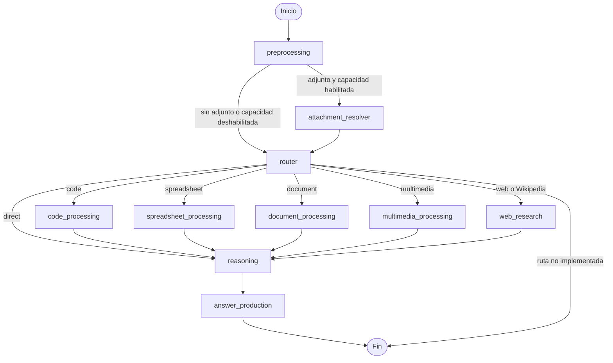

# Objetivo del ejercicio

Construir un sistema que de respuesta a las preguntas GAIA (batería de preguntas para evaluar sistemas IA, uso de distintas herramientas...) Parece que hay distintos niveles de complejidad, se queda en dar respuesta a 20 preguntas del nivel 1 (hay que conseguir más de un 30% de acierto)

## Restricciones

Exact Match en la respuesta, la respuesta debe incluir (nunca mejor dicho) la propia respuesta y nada más, sin florituras ni adornos ni texto adicional.

# Preguntas GAIA

Se proporcionan una serie de endpoint para acceder a las preguntas (https://agents-course-unit4-scoring.hf.space/docs#/default/get_random_question_random_question_get)

De primeras hacemos uso del endpoint GET /random-question, y analizamos un par de preguntar para ver que nos vamos a encontrar:

1. How many studio albums were published by Mercedes Sosa between 2000 and 2009 (included)? You can use the latest 2022 version of english wikipedia.

Parece una pregunta en la que el sistema deberá recurrir a una herramienta de búsqueda web o más en concreto incluso conector de wikipedia. Deberá buscar 'studio albums' de 'Mercedes Sosa' y filtrar a los publicados entre el 2000 y 2009.

Resumen: wikipedia/web + leer wikipedia + extraer studio albums + filtro fechas
Evidencias de entrada: Wikipedia (es una recomendación) asi que por asegurar una vez construída la primera respuesta podría revisarse con búsqueda web de discografía
Indicios de entrada: La query contiene Wikipedia el campo file_name viene vacío

2.
```
{
  "task_id": "f918266a-b3e0-4914-865d-4faa564f1aef",
  "question": "What is the final numeric output from the attached Python code?",
  "Level": "1",
  "file_name": "f918266a-b3e0-4914-865d-4faa564f1aef.py"
}
```

Parece que se nos proporciona un código python y tiene que evaluar su salida numérica. Será necesario contar con un interprete de python y quizás el módulo math.

Resumen: interprete python
Evidencias de entrada: file_name además termina en .py lo que ya nos debe llevar a interprete de python

3.
```
{
  "task_id": "bda648d7-d618-4883-88f4-3466eabd860e",
  "question": "Where were the Vietnamese specimens described by Kuznetzov in Nedoshivina's 2010 paper eventually deposited? Just give me the city name without abbreviations.",
  "Level": "1",
  "file_name": ""
}
```

Se me ocurre que como el fichero no se proporciona necesitará buscar ese paper en la web y si existe tendrá que analizarlo con OCR extrayendo información relevante que irá al llm para intentar dar respuesta a la pregunta (chunks, embedings...)

Creo que hay mecanismos de extracción de info directa que no hay que llegar a algo tipo chunks+embeddings (derivado de la idea de RAG)

Resumen: web + lectura fichero + extraer información
Evidencias de entrada: file_name vacío Abierta

4.
```
{
  "task_id": "7bd855d8-463d-4ed5-93ca-5fe35145f733",
  "question": "The attached Excel file contains the sales of menu items for a local fast-food chain. What were the total sales that the chain made from food (not including drinks)? Express your answer in USD with two decimal places.",
  "Level": "1",
  "file_name": "7bd855d8-463d-4ed5-93ca-5fe35145f733.xlsx"
}
```

Inteprete de documentos excel, tendrá que entenderlo, sumar y excluir filas del total y por último formatear la salida para que se ajuste a USD con 2 decimales. En este caso es un trabajo local en el fichero no necesita búsqueda o ampliación de información.

Resumen: lector excel (estructura tabla) + filtro filas (entender texto filas para poder filtrar drinks) + módulo math + dar formato
Evidencias de entrada: file_name .xlsx

En este caso parece que hay partes que se pueden resolver de forma determinista. El LLM puede interpretar qué significa "food" en las filas y traducir la pregunta a una operación estructurada (por ejemplo, sumar la columna de ventas filtrando la categoría comida). Una vez definida esa operación, Python debería aplicar el filtro y hacer la suma, evitando delegar aritmética al LLM.

No todas las preguntas sobre Excel se podrán expresar como una operación sencilla. Si la pregunta requiere comparar tablas, encontrar relaciones, ordenar resultados o realizar varios pasos que no quepan en ese plan, no conviene forzarla ni simplificarla: se pasa el libro al análisis general del LLM. Así se aprovecha el cálculo determinista cuando encaja y se conserva una vía flexible para las preguntas más abiertas.

5.

```
{
  "task_id": "4fc2f1ae-8625-45b5-ab34-ad4433bc21f8",
  "question": "Who nominated the only Featured Article on English Wikipedia about a dinosaur that was promoted in November 2016?",
  "Level": "1",
  "file_name": ""
}
```

Conector wikipedia, lector web y extraer la info requerida.

Resumen: wikipedia/web + lector web
Evidencias de entrada: file_name vacío + Wikipedia

## Wikipedia??
Lo he investigado y hay tools específicas de wikipedia, lo que creo que en este caso es que puede venir bien contar directamente con la tool de wikipedia, viendo que en las preguntas de ejemplo un par indicaban Wikipedia explícitamente, ayudaría a ese mayor control y centrar el foco.

## Highligths

Hay preguntas que pueden incluir referencias a fichero, en ese caso necesitaremos utilizar el endpoint /files/{task_id} para obtener dicha información.

Ya podemos apreciar una serie de herramientas requeridas:
- Acceso a búsqueda web (no sé si existe un conector/tool específico de wikipedia)
- Lectura de páginas web
- Lectura de ficheros diferente extensión (pdf, excel)
- Interprete de código
- ...

# Primeras pinceladas de arquitectura

En el curso se presento una serie de nociones relacionadas con la libertad y el control. Según avanzabamos en los framework y complejidad ibamos ganando control y reduciendo libertad en el llm (smolagents==freedom vs LanghGraph >> control)

Apareciendo la idea de Agentes vs Workflow, libertad vs determinismo. Con el primer análisis y viendo que las preguntas necesitan una respuesta lo más concreta y acotada posible, creo que puede venir bien una arquitectura de workflow, en la que los primeros pasos nos lleven a una fuente concreta de forma determinista. Me refiero a que en varias de las preguntas parece observarse que cuando se acompaña de un fichero la respuesta viene en ese fichero o se obtiene de él, por lo que darle grados de libertad permitiría al LLM irse a buscar en otra fuente o ampliar la respuesta con otras fuentes, sib embargo el workflow permitiría deligar los caminos y tirar por el fichero unicamente o por otras (normalmente me imagino que websearch) por ejemplo.

La arquitectura workflow creo que también nos puede ayudar a acotar la forma de la respuesta en relación a limpiar texto y exact match.

```
                 QUESTION
                    │
                    ▼
              deterministic
              preprocessing
                    │
         ┌──────────┴──────────┐
         │                     │
   attached file           no attached file
         │                     │
         ▼                     ▼
   local evidence          agentic research (FREEDOM)
         │                     │
         └──────────┬──────────┘
                    ▼
                evidence (se extrae una información de valor para dar respuesta, si no la hay, incluso quizá habría que volver a darle una vuelta)
                    │
                    ▼
              reasoning (FREEDOM)
                    │
                    ▼
          deterministic output
               formatting
(Todo lo determinista que se pueda, pero vamos a requerir LLM alguien tiene que interpretar que se pide)
                    │
                    ▼
          submitted_answer
```

Una capacidad crítica o crucial del sistema será que sea capaz de seleccionar fuente, es decir en el punto tras el preprocessing deberá ser capaz de determinar si hay un fichero adjunto o no, en caso de que no lo haya tendrá que investigar otras fuentes externas no proporcionadas por la pregunta (me imagino que habrá preguntas que se queden incluso antes, y ya la propia pregunta contenga las entradas de la respuesta. Por ejemplo, una operación matemática donde los operandos vienen como parte de la query)

Para este último claso hablaríamos de algo tipo:
```
no file
  │
  ▼
¿se puede resolver con la información proporcionada? (Razonamiento, no es determinista ya que es dificil de acotar)
  │
 ┌┴────────────┐
 sí            no
 │              │
 ▼              ▼
reasoning      external research
```

## Otras decisioness
### Extensión del fichero
Si viene un fichero este tendrá una extensión y está sería un gran indicativo de por donde seguir:
.py --> Interprete de código (no tiene porque ejecutar, puede ser analizar, calcular...)
.pdf --> lector de documento
...
tengo la duda de si es mejor workflow o llm y que razone que hacer, creo que quizás ambos o que se le indique al llm .py seguramente implique interprete de código, ya que no sé si pueden existir preguntas que busquen confundir. Creo que lo bueno es que no hay elegir que podemos convinar sin malgastar.

Investigando creo que lo mejor es el routing determinista apoyando lo que no sabemos en el llm:
```
                   QUESTION
                      │
                      ▼
         DETERMINISTIC ROUTING
                      │
       ┌──────────────┼──────────────┐──────────────┐
       ▼              ▼              ▼              ▼
     .py            .xlsx          no file         ...
       │              │              │
       ▼              ▼              ▼
      LLM            LLM            LLM
    DECISION       DECISION       DECISION
                                     │
                            ┌────────┴────────┐
                            ▼                 ▼
                     sufficient input     missing info
                            │                 │
                            ▼                 ▼
                         reasoning         research
                                             (open,
                                             certain source for example, wikipedia)
```

LLM decisión será una decisión semántica, ya he decidido de forma determinista que voy a trabajar con un fichero concreto, pero que tengo que hacer con él? necesito algo más? está la evidencia que permite responder ?

# Routing vs Razonamiento

Creo que son los pilares del sistema. Routing en cuanto el camino a seguir, alcanzado un punto y con un mensaje a donde voy; y razonamiento, ahora que tengo una respuesta/información como la utilizo para continuar; y se retroalimentan entre ellas.

En este caso en el que las respuesta ha de contener unicamente la "respuesta" añadiría una última pata de producción/redacción de la misma. Un LLM seguramente dará una respuesta formulada y en este caso hay que devolver lo justo.

## Selección de evidencias y presupuesto de contexto

No conviene entregar al razonador todo el contenido de un PDF, una página web o un artículo de Wikipedia. Los lectores de cada fuente deberían extraer texto y conservar su procedencia (por ejemplo, número de página o URL); después, una capacidad común puede dividir ese texto en fragmentos y seleccionar los que mejor responden a la pregunta. Así, la obtención del texto depende del formato, mientras que la selección de información útil se reutiliza entre fuentes.

El razonador recibe esos fragmentos como evidencias con su referencia, en lugar de un volcado completo del documento. Se mantiene un presupuesto máximo de contexto para reducir tokens de entrada y tiempo de inferencia, y se conserva el contexto cercano mediante fragmentos con solapamiento. Si la fuente es pequeña, se puede entregar completa. La selección léxica es eficiente, pero puede pasar por alto información expresada con sinónimos; por ello, se debe preservar la posibilidad de mejorar el ranking con una etapa semántica cuando las pruebas indiquen que hace falta, sin volver a enviar siempre el texto entero.

La selección no debería convertirse en un resumen que reemplace o mezcle los datos originales. Para estas preguntas interesa conservar el fragmento textual concreto y su fuente, ya que el razonador necesita suficiente contexto para interpretar la evidencia y producir una respuesta verificable. El límite de contexto debe reducir información irrelevante, no borrar matices necesarios para contestar.

### Ajuste al benchmark GAIA

En este proyecto, las preguntas son acotadas y normalmente buscan un dato concreto en una fuente identificable. Por eso tiene sentido empezar con una estrategia sencilla y trazable: conservar la página o URL, dividir el texto con algo de solapamiento, recuperar por coincidencia léxica y enviar al razonador un conjunto limitado de fragmentos originales. Así evitamos un volcado completo sin añadir llamadas extra al LLM. La recuperación léxica puede perder información expresada con vocabulario distinto; habrá que medir ese fallo antes de aumentar la complejidad.

### Estrategias para sistemas con corpus o preguntas más complejos

Si las preguntas requieren relacionar muchas fuentes, seguir cadenas de evidencia o responder consultas variadas sobre documentos extensos, hay estrategias más potentes que se pueden combinar:

- **Recuperación híbrida y reranking:** combinar búsqueda léxica (por ejemplo, BM25) con embeddings para encontrar coincidencias semánticas; después, un reranker vuelve a ordenar los candidatos según la pregunta. El modelo grande recibe los fragmentos originales mejor clasificados, con sus fuentes.
- **Recuperación jerárquica:** crear resúmenes organizados por secciones o grupos de documentos para localizar primero el área pertinente y luego recuperar pasajes originales de esa sección. RAPTOR describe una estructura recursiva de resúmenes para recuperar información a distintos niveles de abstracción ([paper](https://proceedings.iclr.cc/paper_files/paper/2024/file/8a2acd174940dbca361a6398a4f9df91-Paper-Conference.pdf)). Los resúmenes sirven para navegar el corpus; la respuesta final debería poder volver a las fuentes originales.
- **Cascada de modelos:** un modelo pequeño puede clasificar la pregunta, seleccionar o puntuar fragmentos y resolver tareas sencillas; se escala al modelo grande cuando la confianza es baja o la evidencia requiere más razonamiento. FrugalGPT estudia cascadas que eligen entre modelos para reducir coste manteniendo la calidad ([paper](https://arxiv.org/abs/2305.05176)). El modelo pequeño puede añadir latencia si se ejecuta siempre, así que conviene medirlo con la batería real.
- **Recuperación iterativa con verificación:** el razonador identifica qué evidencia falta, hace otra búsqueda y comprueba si los pasajes recuperados sostienen la respuesta. Self-RAG estudia la recuperación adaptativa y la reflexión sobre la relevancia y el apoyo de las fuentes ([paper](https://arxiv.org/abs/2310.11511)).

Estas estrategias cuestan más en implementación, almacenamiento, llamadas o latencia. En GAIA empezaría por evaluar la recuperación léxica contra las preguntas reales y conservaría los fragmentos originales; embeddings, reranking, modelos pequeños o recuperación iterativa se añadirían cuando los errores observados muestren que el selector actual no encuentra evidencia suficiente.


# Profundizando en recorrido Pregunta concreta

Tomando como ejemplo:

2.
```
{
  "*task_id*": "f918266a-b3e0-4914-865d-4faa564f1aef",
  "*question*": "What is the final numeric output from the attached Python code?",
  "Level": "1",
  "*file_name*": "f918266a-b3e0-4914-865d-4faa564f1aef.py"
}
```

Tenemos el task_id para la obtención de files si existen (que en este caso sí)
Tenemos la query "question"
Y el nombre del fichero file_name (recordemos que puede venir vacío)

Lo primero al detectar presencia file_name (!= "") procedemos a descarga haciendo uso de /files/{task_id}

> [!warning]
> El endpoint oficial de la Unidad 4 `/files/{task_id}` devuelve actualmente errores 404 para
> las tareas que incluyen archivos adjuntos debido a una incompatibilidad en las rutas
> introducida tras la migración del formato del dataset GAIA.
> Para el desarrollo local, los archivos adjuntos se obtienen directamente desde el dataset
> oficial `gaia-benchmark/GAIA`.

Lo solucionamos con un conector simple para la recuperación de adjuntos. Esto nos lleva a darnos cuenta que la obtención del fichero puede fallar, en ese caso el sistema debería dar respuesta por otras vías, pero indicar que no se pudo obtener el fichero adjunto. En algunos casos la respuesta puede tener sentido, por ejemplo cuando el fichero es un paper y ese paper se puede obtener también de la web y en otras no, por ejemplo análisis de excel concretos que no están públicos, o códigos...

Pero supongamos que obtuvimos ese ficheo (seguramente el path), recordemos .py --> *file_path*

El workflow nos llevará directamente a la rama .py

Analizar código hasta conseguir la evidencia --> *evidence*

Pasar la evidencia al LLM para determinar que sea la respuesta a la pregunta --> *answer*

Normalizar/Limpiar answer --> *final_answer*

Alcanzado este punto, aun no veo ninguna evidencia de pasar al concepto multi-agent visto en el curso. De momento, parece que con un workflow+llm+tools tendríamos un sistema suficiente.

# Diseño incial del Estado - STATE

| Campo | Por que es necesario? | Creado por | Usado por |
|---|---|---|---|
| `task_id` | Identifica la tarea, da acceso a los archivos adjuntos | Dado en la pregunta | Obtención de adjuntos |
| `question` | La query | Dado en la tarea | Creo que todos, es la query principal, me imagino que se arrastrará como contexto |
| `file_name` | la extensión define la ruta | Dado | Router |
| `file_path` | Donde encontrar el fichero, lo utilizará el downloader | Obtenido a partir del task id y el método GET correspondiente (conector propio ante error) en caso de error en obtención actuará también de indicativo de fallo (`Path \| None`, hay `file_name != ""` y `file_path == None` entonces hubo fallo en obtención) |  |
| `route` | Se asocia a la capacidad principal seleccionada (code, document, direct, web, wikipedia...) |  |  |
| `evidence` | Información de valor obtenida de fichero, fuente externa, web... | Tools+LLM | LLM para analizar si es suficiente evidencia y generar la respuesta filtrada y completa |
| `answer_candidate` | Respuesta generada a partir de la evidencia, aplicando filtros, limpiezas y adecuación a la pregunta principal | LLM | LLM |
| `submitted_answer` | Exact match | Normalización, limpieza... | POST `/submit` |

Pero revisando el curso se le puede dar una vuelta más a este estado. Los campos no tienen porque ser tipos básicos (str, int) sino que podemos hablar de estructuras de "Objeto" Por ejemplo, evidence podría tener una estructura:

```
evidence:
[
    {
        content: ...,
        source_type: ...,
        source: ...
    },
    ...
]
```

LLevada a una de las preguntas:
```
[
    {
        content: "Mercedes Sosa released ...",
        source_type: "wikipedia",
        source: "https://en.wikipedia.org/..."
    },
    ...
]
```

Ganamos información que el LLM aprovechará y darán mayor robustez y trazabilidad al sistema, más allá de este caso concreto en el que buscamos una respuesta acotada.

Limpio/Resumido el estado quedaría algo como:
| Campo | Para qué sirve | Creado por | Usado por |
|---|---|---|---|
| `task_id` | Identifica la tarea y permite localizar recursos asociados | Unit 4 | attachment resolver, evaluación |
| `question` | Problema principal que hay que resolver | Unit 4 | routing semántico, tools, reasoning, answer production |
| `file_name` | Indica si se espera adjunto y permite inferir su tipo | Unit 4 | preprocessing/router |
| `file_path` | Ruta local al adjunto cuando se ha podido recuperar | attachment resolver | rama especializada de fichero |
| `route` | Representa la capacidad/ruta seleccionada | router | conditional edges / procesamiento |
| `evidence` | Información recuperada junto con su procedencia | tools/nodes | validación de evidencia y reasoning |
| `answer_candidate` | Conclusión semántica obtenida de la evidencia | reasoning | answer production |
| `submitted_answer` | String final que cumple las restricciones GAIA | answer production | POST `/submit` |

Y ahora que tenemos el estado ya vamos callendo sin querer a un grafo final (arquitectura de Nodo)

## El grafo - Nodos
task_id / question / file_name
              │
              ▼
         preprocessing
              │
      ┌───────┴────────┐
      │                │
file_name != ""     no file
      │                │
      ▼                │
attachment_resolver    │
      │                │
      ▼                │
  file_path            │
      │                │
      └───────┬────────┘
              ▼
            router
              │
              ▼
            route
              │
              ▼
      (conditional edge by type)
              │
              ▼
     evidence acquisition
              │
              ▼
           evidence
              │
              ▼
           reasoning
              │
              ▼
       answer_candidate
              │
              ▼
      answer production
              │
              ▼
      submitted_answer

# STATE - Limpieza en base a uso

Necesitamos saber en concreto que Nodo es el primero en escribir cada propiedad y los siguientes en consumirlo. De la literatura he podido extraer una recomendación, si solo un nodo interactúa con un campo este seguramente se pueda manejar como una variable local y no sea necesario que forme parte del estado.


task_id INPUT-->preprocessing-->attachment_resolver
question INPUT-->preprocessing-->router-->evidence_acquisition-->reasoning-->answer_production (presente en todas las "fases")
file_name INPUT-->preprocessing-->router
file_path attachment_resolver-->router(va también al router, por si no se puede recuperar el archivo y hay que recurrir a la posibilidad de irse a otras fuentes)-->evidence_adquisition
route router
evidence evidence_acquisition-->reasoning
answer_candidate reasoning --> answer_production
submitted_answer answer_production-->POST

# Arquitectura ejecutable mínima

Decidir de lo que tenemos hasta ahora que se traduce en un nodo real del grafo y que se traslada a una simple función previa.

Hasta ahora el flujo ya apunta a algo así:
```
START
  ↓
preprocessing
  ↓
¿hay fichero?
  ├── sí → attachment_resolver
  └── no
          ↓
        router
          ↓
   conditional edges
    ├── code ──────────┐
    ├── spreadsheet ───┤
    ├── document ──────┤→ evidence → reasoning
    ├── web ───────────┤
    ├── wikipedia ─────┘
    └── direct ────────────→ reasoning (question only)
          ↓
    answer_production
          ↓
         END
```

pero por ejemplo preprocessing se encargará de funciones simples, existe porque es una etapa habitual en el tratamiento de datos entrada, en este caso la mantendremos pero puede que no fuese del todo necesaria. Esta etapa trabajará únicamente con task_id, question y file_name; datos que ya vienen de una base de datos tratada, por lo que preprocessing podría no ser necesario, aún así podemos vincularlo a tareas tipo: limpieza espacios en question, normalizar file_name, derivar la extensión, detectar si hay el adjunto esperado, validar que esos campos mínimos existan. Hacer por ejemplo lo de derivar la extensión implica añadir ese campo derivable al State por lo que hay que tener cuidado, ya que por definición campos facilmente derivables no deberían formar parte del estado.

Por otro lado, el check de fichero puede ser parte del propio router, no creo que tenga suficiente caracter para ser un nodo ya que tan solo comprobará si existe el campo filename. Puede justificarse cierto calado únicamente debido al acceso al recurso para obtener el file_path a través del conector custom debido al error 404 del método GET.

evidence_acquisition no es necesario reflejarlo directamente, la evidencia es la salida de cada rama empleada en el condicional previo.

```
START
  ↓
preprocessing (función simple, comprueba campos mínimos task_id y question y limpia espacios de question)
  ↓
¿file_name != ""?--¿hay fichero?
  ├── sí → attachment_resolver (attachment_resolver es quién se encarga de obtener el file_path)
  └── no
          ↓
        router
          ↓
   conditional edges
    ├── code ──────────┐
    ├── spreadsheet ───┤
    ├── document ──────┤→ evidence → reasoning
    ├── web ───────────┤
    ├── wikipedia ─────┘
    └── direct ────────────→ reasoning (question only)
          ↓
    answer_production
          ↓
    submitted_answer
          ↓
         END
```


| Nodo | Lee | Escribe | Determinista / LLM | Tool externa |
|---|---|---|---|---|
| preprocessing | `task_id`, `question`, `file_name` | `question`, `file_name` | Determinista | No. Código Python para validación, normalización y limpieza |
| attachment_resolver | `task_id`, `file_name` | `file_path` | Determinista | Sí/No según implementación. Acceso al endpoint oficial o al dataset GAIA |
| router | `question`, `file_name`, `file_path` | `route` | Determinista por extensión si hay adjunto; sin adjunto usa el LLM para elegir `direct`, `web` o `wikipedia` | No necesariamente |
| code_processing | `question`, `file_path` | `evidence` | Híbrido | Lectura/análisis/ejecución controlada de código |
| spreadsheet_processing | `question`, `file_path` | `evidence` | Híbrido: el LLM interpreta la pregunta y propone un plan; Python ejecuta las operaciones soportadas; si el plan no basta, se usa análisis general del LLM | Lector y procesamiento tabular |
| document_processing | `question`, `file_path` | `evidence` | Determinista | Extrae texto PDF con referencia de página y delega el troceado y selección al selector común; OCR queda como mejora futura para documentos escaneados |
| web_research | `question`, `route` | `evidence` | Búsqueda y extracción deterministas; razonamiento posterior con LLM | DDGS para web general; Europe PMC para publicaciones de ciencias de la vida; API MediaWiki para Wikipedia; selector común conserva URL |
| direct (ruta, no nodo) | `question` | — | El router la selecciona semánticamente; pasa directamente a reasoning sin evidencia externa | No |
| reasoning | `question`, `evidence` (opcional en ruta directa) | `answer_candidate` | LLM | Normalmente no |
| answer_production | `question`, `answer_candidate` | `submitted_answer` | Híbrido: LLM para interpretar restricciones + normalización determinista cuando sea posible | Normalmente no |

Recordemos que evidence será una lista de objetos:

```
evidence = [
  {
    content: ...,
    source_type: ...,
    source: ...
  },
  ...
]
```

Creo que de momento con esos 3 subcampos es suficiente para generar un sistema robusto a las preguntas analizadas. Además ha de ser una lista porque una pregunta creo que puede llegar a requerir evidencias multifuente.

# Un vistazo más a las preguntas

Dimos un repaso más a las posibles preguntas mediante el método GET /random-question y descubrimos un abanico más amplio de fuentes/tipos de pregunta:

```
{
  "task_id": "99c9cc74-fdc8-46c6-8f8d-3ce2d3bfeea3",
  "question": "Hi, I'm making a pie but I could use some help with my shopping list. I have everything I need for the crust, but I'm not sure about the filling. I got the recipe from my friend Aditi, but she left it as a voice memo and the speaker on my phone is buzzing so I can't quite make out what she's saying. Could you please listen to the recipe and list all of the ingredients that my friend described? I only want the ingredients for the filling, as I have everything I need to make my favorite pie crust. I've attached the recipe as Strawberry pie.mp3.\n\nIn your response, please only list the ingredients, not any measurements. So if the recipe calls for \"a pinch of salt\" or \"two cups of ripe strawberries\" the ingredients on the list would be \"salt\" and \"ripe strawberries\".\n\nPlease format your response as a comma separated list of ingredients. Also, please alphabetize the ingredients.",
  "Level": "1",
  "file_name": "99c9cc74-fdc8-46c6-8f8d-3ce2d3bfeea3.mp3"
}
```

Lo importante, capacidad de procesar audio. Como mínimo capacidad de transcribir para que el LLM pueda procesarlo, pero iría un paso más allá y contemplaría reconocer sonidos o música, no solo trasncribir.

```
{
  "task_id": "2d83110e-a098-4ebb-9987-066c06fa42d0",
  "question": ".rewsna eht sa \"tfel\" drow eht fo etisoppo eht etirw ,ecnetnes siht dnatsrednu uoy fI",
  "Level": "1",
  "file_name": ""
}
```

Una pregunta mal escrita? No la acabo de ver. Habrá que ver que dice el razonador, pero sin duda entraría por esa rama directa del router, veremos si es capaz de dar una respuesta válida.

```
{
  "task_id": "a1e91b78-d3d8-4675-bb8d-62741b4b68a6",
  "question": "In the video https://www.youtube.com/watch?v=L1vXCYZAYYM, what is the highest number of bird species to be on camera simultaneously?",
  "Level": "1",
  "file_name": ""
}
```

Conector de videos de youtube? Existe algo similar o es el propio el llm el que se encarga. Creo que existirá algo que permita explotar mejor la info de esta fuente. Será algo similar a audio, transcripción seguro, pero al ser un video puede tener más complejidad si requiere algo de entendimiento visual (reconocimiento de frames, VLM) Ir con cuidado sin pasarse ya que con análisis de video puede ser sencillo ir a máximos y estar desaprovechando recursos, por ejemplo, análisis visual exaustivo (consumo de tokens disparado) y las preguntas no lo requieren (puede estar injustifidicado o solo justificarse en algunas preguntas)

```
{
  "task_id": "cca530fc-4052-43b2-b130-b30968d8aa44",
  "question": "Review the chess position provided in the image. It is black's turn. Provide the correct next move for black which guarantees a win. Please provide your response in algebraic notation.",
  "Level": "1",
  "file_name": "cca530fc-4052-43b2-b130-b30968d8aa44.png"
}
```

Una imagen como fuente de entrada, necesitamos un componente que permita analizar imágenes, un VLM?

Y creo que con esto el abanico quedaría bastante completo, y siempre hay la opción de que ante algo desconocido el razonador sea quien decida (el beneficio de contar siempre con cierta libertad) Capacidades extra que ya apreciamos en las preguntas: podría ser el tema del ajedrez, no dejarlo al llm y acotar un poco el campo, el llm me da posiciones el motor (mucho más certero o centrado en tarea) me da la respuesta/jugada.

## Rama de procesamiento multimedia

Para las preguntas cuyo material de entrada sea audio, imagen o vídeo, se añadirá una rama multimedia única al router y un nodo de entrada común, `multimedia_processing`. El nodo actuará como punto de coordinación y entregará evidencias al flujo compartido de razonamiento. El procesamiento concreto se mantendrá modular por modalidad, porque cada tipo de recurso necesita operaciones, modelos y límites diferentes; no se concentrará toda la lógica en una función monolítica.

```text
router (modalidad detectada por el adjunto)
  └── multimedia
        └── multimedia_processing
              ├── audio: transcripción y análisis acústico bajo demanda
              ├── imagen: análisis visual mediante VLM
              └── vídeo: transcripción y muestreo limitado de fotogramas
                    ↓
              selección común de evidencias
                    ↓
                 reasoning
```

La extensión del adjunto permite reconocer la modalidad, pero la pregunta debe guiar qué análisis se necesita. En audio se transcribirá el habla cuando la respuesta dependa de lo dicho; el reconocimiento de sonidos, música u otros eventos se activará cuando la pregunta requiera información acústica que la transcripción no conserva. Así, una voz memo con una receta puede resolverse a partir de su transcripción, mientras que una pregunta sobre una canción o un sonido requiere análisis de audio.

Para imágenes se contempla un VLM local de tamaño moderado, suficiente como punto de partida para describir la imagen y extraer la información visual que pida la pregunta. No se presupone que un VLM resuelva por sí solo tareas especializadas: por ejemplo, una posición de ajedrez podría requerir convertir la imagen a una representación de tablero y consultar un motor de ajedrez si las preguntas evaluadas justifican esa capacidad.

En vídeo se priorizará la transcripción del audio y una selección pequeña de fotogramas distribuidos en el tiempo, en lugar de analizar cada frame. Si la pregunta depende de un evento visual breve o de contar elementos simultáneos, se podrá ampliar el muestreo en los intervalos pertinentes. La estrategia debe aportar señales visuales útiles manteniendo acotados el cómputo y los recursos de inferencia.

La separación propuesta es, por tanto, una sola rama y un nodo de entrada en el grafo, con procesadores internos específicos para audio, imagen y vídeo, además de una salida común de evidencias con procedencia. Solo será necesario convertir los procesadores en nodos LangGraph independientes si aparecen requisitos concretos de reintentos, límites de recursos, ejecución condicional o evaluación aislada por modalidad.

### Implementacion inicial

La rama `multimedia_processing` ya esta conectada al grafo. Utiliza Whisper `small` para transcripcion, AST AudioSet para reconocer eventos acusticos cuando la pregunta lo necesita y SmolVLM `256M` para examinar imagenes y fotogramas. Instala sus dependencias con `uv sync --extra multimedia`. `MEDIA_VLM_IDLE_SECONDS` determina cuanto tiempo queda cargado el modelo visual tras su ultima inferencia (300 segundos por defecto); despues se libera de memoria y se vuelve a cargar al procesar otra imagen o video que requiera analisis visual.

La misma politica de inactividad se aplica a Whisper y AST: cada modelo se carga solo al requerir transcripcion o clasificacion, y se libera tras el periodo configurado sin uso.

## Grafo resultante antes de los cambios para reducir latencia

Este es el grafo implementado antes de probar los cambios descritos en el apartado siguiente. El preprocesamiento resolvía los adjuntos habilitados y el router elegía una rama según la pregunta y las capacidades del experimento. Cada rama especializada generaba evidencias para el razonador; la ruta directa omitía esa investigación. La producción de la respuesta final era un nodo independiente.



La configuración del experimento podía deshabilitar capacidades y hacer que el flujo usara la ruta directa. En ambos casos, el razonador recibía la pregunta y, cuando la rama seleccionada había encontrado material útil, las evidencias asociadas.

## Latencia observada y cambios intentados para mejorar la fluidez

Al ejecutar la batería observamos que el sistema respondía, pero algunas preguntas tardaban en completarse. La demora se notaba especialmente cuando se encadenaban llamadas al LLM o se necesitaba procesar contenido multimedia, como audio o vídeo. También aparecieron errores al faltar dependencias opcionales para descargar y analizar vídeo.

Para reducir trabajo innecesario y hacer el flujo más ágil, se probaron estos cambios:

- Integrar la producción y normalización de la respuesta final en la llamada de razonamiento, eliminando una llamada adicional al LLM y el nodo `answer_production`.
- Acotar la generación en las decisiones breves del router y en los planes de código y cálculo, sin recortar del mismo modo la respuesta razonada.
- Ejecutar en paralelo la extracción de resultados web independientes.
- Evitar transcribir audio cuando la pregunta sobre el vídeo solo necesita analizar lo visual y evitar cargar modelos de audio para preguntas que no dependen del sonido.
- Muestrear un conjunto limitado de fotogramas del vídeo, en vez de decodificarlo entero, y limitar la longitud de la descripción visual.
- Hacer que el script de arranque instale también el grupo opcional de dependencias multimedia para que las preguntas de vídeo dispongan de sus dependencias.

Estos cambios buscan reducir llamadas, cómputo y esperas evitables. Aún no se ha realizado una comparación controlada de tiempos antes y después; por tanto, no se atribuye una mejora cuantificada. El procesamiento local de modelos y la descarga o lectura de recursos externos todavía pueden añadir latencia, y conviene medir la batería completa con configuraciones comparables para identificar qué ramas concentran la demora.

## Segunda versión del pipeline: revisión de evidencias y capacidad de continuar

La batería analizada completó las veinte tareas con tres aciertos según el evaluador local (15 %), 146 segundos acumulados y 7,3 segundos de media. Completar una tarjeta no implica acertar: aparecieron errores de herramientas, respuestas incompletas, interpretaciones incorrectas y formatos que no respetaban la pregunta. Estos resultados motivan revisar tanto la configuración del modelo como la forma de obtener y comprobar evidencias.

Se conserva la separación por modalidades y el uso de LangGraph. Se incorpora un revisor común que puede solicitar búsquedas reformuladas, abrir enlaces HTML o PDF, realizar cálculos sin un adjunto de código y ampliar el muestreo de un vídeo. Después de cada acción se vuelve a revisar la suficiencia de la información, con límites de acciones, llamadas y tiempo. La ruta directa inicial puede continuar investigando; el perfil Solo directo mantiene deshabilitadas las herramientas para poder medir esa alternativa.

La resolución vuelve a disponer de un presupuesto independiente de la producción de respuesta. Se permite el conocimiento general estable y se reserva la evidencia para respaldar los hechos vinculados a fuentes concretas. La respuesta final comprueba algunas restricciones mecánicas y permite una reparación. Se detecta el truncamiento del LLM, se conservan los fallos recuperables de adquisición y se elimina el atajo específico de contar filas de Wikipedia en el razonador.

La reducción de contexto sigue siendo necesaria. El revisor recibe fragmentos seleccionados y procedencia, además de enlaces que permiten continuar la investigación. La selección léxica conserva sus límites: puede omitir relaciones relevantes y no reemplaza una comprobación semántica de suficiencia. La nueva capacidad de pedir más información permite recuperar parte de lo que una sola extracción habría descartado.

Cada pregunta conserva una traza local con decisiones, fuentes, entradas y salidas de modelos, datos de terminación y tiempos por etapa. Los experimentos completos se persisten también en el servidor. Así se podrá distinguir una mejora real de acierto de un cambio de latencia o de formato, comparando el mismo conjunto de tareas y configuración. La evaluación posterior de la V2 obtuvo 6/20 aciertos (30 %) con 47,3 segundos de media. El detalle del grafo y de los límites implementados se recoge en [pipeline-v2.md](pipeline-v2.md).

## Conservación de la referencia V2 y evaluación de las versiones posteriores

La V2 funcional se conserva como punto de partida, junto con el experimento original,
sus veinte trazas y una copia del código en una revisión concreta de Git. El panel
la identifica como «V2 · Completo · referencia» sin cambiar las respuestas ni la
configuración histórica. Las mejoras propuestas para la V3 deben poder evaluarse
individualmente y en conjunto, manteniendo comparables las preguntas, el modelo y
las condiciones de ejecución. No se presupone que aumentar herramientas o llamadas
mejore el resultado: cada cambio debe registrar aciertos, regresiones, errores y
tiempos, además de sus dependencias con otras mejoras.

El historial de arquitectura, resultados, limitaciones, conservación y protocolo
experimental se recoge en [evolucion-pipeline.md](evolucion-pipeline.md). Las variantes
V3 descritas allí son un plan; no representan experimentos ejecutados.
