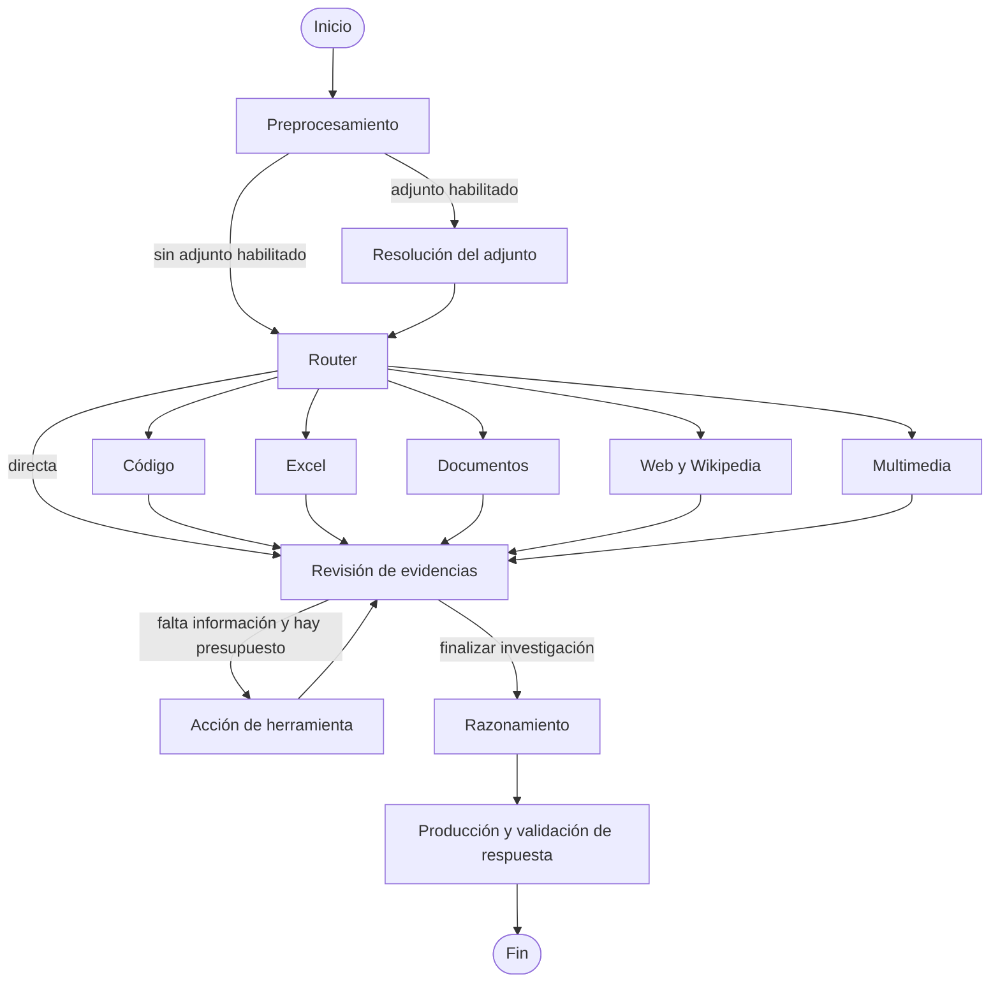

# Evolución y evaluación del pipeline

Este documento conserva el punto de partida funcional y registra la evolución
del agente. Cada versión debe describir su arquitectura, decisiones, configuración,
resultados y limitaciones. Una mejora propuesta no se considera validada hasta
compararla con la referencia y con el conjunto de cambios.

## V2: primera referencia funcional conservada

La V2 amplió el flujo inicial de adquisición y respuesta con revisión de evidencias
y acciones adicionales acotadas. Su implementación se incorporó en `508dbad`.
La revisión conservada antes de iniciar la V3 es
`a9125ee963fa23614409e0928dd260c071394500`, que añade también la publicación del
portfolio. El detalle técnico original está en [pipeline-v2.md](pipeline-v2.md).

### Construcción y decisiones

Se mantuvo LangGraph como orquestador y un estado tipado común. La extensión del
adjunto selecciona capacidades conocidas; el LLM interpreta las preguntas sin
adjuntos. Las ramas de código, Excel, documentos, web/Wikipedia y multimedia
aportan evidencias con procedencia. El perfil Solo directo deshabilita herramientas.

El enfoque híbrido permite que el LLM decida qué necesita la pregunta y que las
herramientas ejecuten operaciones deterministas. Un archivo Python puede leerse o
ejecutarse. Excel admite un plan de cálculo o análisis general. PDF y páginas web
comparten selección de fragmentos para acotar el contexto. Multimedia permanece
como un nodo único que utiliza VLM, Whisper o clasificación de sonidos según el caso.



La investigación puede reformular búsquedas, abrir fuentes, calcular o examinar
otros instantes de vídeo. Se limita por acciones, llamadas y tiempo. El razonamiento
y la presentación final están separados. Las trazas locales conservan llamadas,
decisiones, evidencias y tiempos, incluso cuando una pregunta falla.

### Configuración y resultados observados

| Campo | Referencia |
|---|---|
| Nombre visible | V2 · Completo · referencia |
| Experimento | `89ff5842-b1bc-4be3-b9c0-3291e97f4afa` |
| Creación registrada | `2026-10-29T18:41:40.914Z` |
| Modelo seleccionado | `Qwen/Qwen3-8B-GGUF:Q5_K_M` |
| Capacidades | Código, Excel, documentos, web y multimedia |
| Resultado oficial y local | 6/20, 30 % |
| Tiempo medio registrado | 47,32232 segundos |
| Llamadas al LLM en las veinte trazas | 105 |
| Generaciones truncadas | 6; aproximadamente 305 segundos acumulados |
| Tiempo del nodo de razonamiento | Aproximadamente el 74 % del total de las trazas |

Estos tiempos corresponden a una ejecución, no a varias repeticiones controladas.
Las trazas registran límites de 240 segundos, 16 llamadas y 4 acciones adicionales,
y presupuestos de 2048 tokens para razonar y 128 para presentar la respuesta.
No debe suponerse que valores de configuración no registrados históricamente
coinciden con los valores actuales. El tiempo de las tarjetas incluye diferencias
de transporte respecto a la suma de etapas.

La batería anterior obtuvo 3/20 y 7,3 segundos de media: proporciona contexto
histórico, pero no constituye una comparación causal controlada con la V2.

### Limitaciones identificadas al preparar la V3

- Generaciones truncadas y reintentos completos concentran parte de la latencia.
- Los vídeos descargados de las dos tareas de YouTube tenían únicamente pista
  de vídeo; la tarea de diálogo no recibió transcripción de audio.
- El VLM produjo una descripción inutilizable del tablero de ajedrez.
- El plan de Excel incorporó exclusiones no solicitadas y una agregación parcial.
- La extracción HTML puede perder texto válido al gestionar elementos vacíos
  dentro de contenedores ignorados.
- La reducción de contexto no conserva todavía una interfaz completa para volver
  a consultar secciones del documento original.
- Las validaciones de salida cubren solo parte de las restricciones del enunciado.
- Los errores HTTP omitían la versión y provocaban la etiqueta `legacy/mixed`.

El registro original mantiene esa etiqueta histórica. El panel añade por separado
`verified_pipeline_version=2` para la referencia identificada, sin modificar su
configuración, respuestas, puntuaciones ni bytes originales. La referencia no se
puede sobrescribir ni eliminar desde la API de experimentos.

### Conservación y reproducción

La copia local está en `.runtime/baselines/v2-reference/`, excluida de Git. Contiene
el código versionado en `source.zip`, la ficha original, las veinte trazas y un
manifiesto con hashes SHA-256. No incluye `.env`, tokens, pesos, medios descargados,
cachés de datasets ni binarios del servidor. El manifiesto detecta modificaciones
accidentales; no sustituye una copia de seguridad externa.

```powershell
uv run python -m huggingface_agents_langgraph.baseline_archive
uv run python -m huggingface_agents_langgraph.baseline_archive --verify
```

La creación valida la identidad de las veinte trazas y es idempotente: si existe
un manifiesto, verifica la copia en lugar de reemplazarla.

Para volver a ejecutar el código conservado sin cambiar de rama:

```powershell
Expand-Archive -LiteralPath .runtime/baselines/v2-reference/source.zip -DestinationPath .runtime/reproductions/v2-reference
Set-Location .runtime/reproductions/v2-reference
uv sync --frozen --extra multimedia
```

Desde ese directorio se configura el acceso a modelos y Hugging Face mediante
variables de entorno o un `.env` privado y se utiliza `scripts/start_agent.ps1`.
Debe detenerse previamente cualquier servicio que ocupe los mismos puertos o
configurarse otro puerto. Esta reproducción aún no se ha ejecutado como batería.
Se conserva el código y el lockfile exactos; no se garantiza identidad de resultados
ante cambios del servidor, pesos, buscador o páginas externas.

## V3: plan aprobado para la evaluación

El trabajo comenzó preservando la referencia, antes de introducir las mejoras.
Las siguientes variantes recogen el diseño experimental aprobado. Su ejecución
posterior y sus resultados se detallan en el cierre de V3 al final del documento.

| Variante prevista | Cambio principal | Comparación |
|---|---|---|
| V2 · Completo · referencia | Ninguno | Registro histórico conservado |
| V2 + control del razonamiento | Presupuestos y recuperación acotada | Frente a V2 |
| V2 + contrato de respuesta | Requisitos tipados y presentación determinista | Frente a V2 |
| V2 + fuentes consultables | Extracción, tablas, secciones y revisiones históricas | Frente a V2 |
| V2 + cálculo y Excel | Operaciones sobre datos reales y planes verificables | Frente a V2 |
| V2 + multimedia | Pistas correctas, transcripción y percepción | Frente a V2 |
| V3 · Completo | Mejoras aceptadas conjuntamente | Frente a V2 y variantes individuales |

Cada cambio tendrá una opción explícita de activación para medir su contribución.
Las dependencias entre cambios quedarán registradas: una variante que necesita
otra capacidad no puede presentarse como una evaluación aislada de aquella.

Se mantendrá inicialmente el mismo modelo. Después se compararán modelos con el
pipeline fijo. Las herramientas candidatas incluyen componentes oficiales de
Hugging Face, navegación textual inspirada en Open Deep Research, Trafilatura,
APIs de revisiones de MediaWiki y búsqueda de publicaciones. Su incorporación
depende de resolver fallos demostrados, sin sustituir LangGraph.

### Protocolo individual y conjunto

1. Registrar hipótesis, revisión del código, capacidades, modelo, parámetros,
   variante, conjunto de preguntas y política de caché.
2. Probar la lógica determinista y los fallos técnicos con pruebas aisladas.
3. Ejecutar la variante sobre las mismas entradas; conservar errores y respuestas
   parciales. No enviar puntuaciones oficiales automáticamente.
4. Comparar aciertos ganados y perdidos, cumplimiento de formato, errores técnicos,
   tiempo medio, mediana, percentil 95, llamadas, tokens y truncamientos.
5. Repetir las mediciones relevantes separando carga inicial y caché. Una única
   ejecución histórica no basta para demostrar una mejora estable de latencia.
6. Evaluar el conjunto acumulado y la V3 completa para detectar interacciones.
7. Revisar casos nuevos o reformulados. Las referencias pertenecen solo al evaluador
   y no se incorporan a prompts, herramientas ni cachés de respuestas.
8. Documentar si se mantiene, ajusta o descarta el cambio, con sus resultados reales.

Objetivo inicial orientativo: superar 6/20 y reducir al menos un 30 % el tiempo
medio respecto a la referencia, sin ocultar regresiones individuales. No es una
garantía de rendimiento. Los nuevos experimentos aparecerán en el panel cuando
se hayan ejecutado; no se crean fichas con resultados simulados.

### Registro de avances

| Paso | Estado | Evidencia |
|---|---|---|
| Archivo de código y registros V2 | Realizado localmente | Manifiesto SHA-256 verificado |
| Identificación de la referencia en el panel | Implementado | Nombre visible separado del registro original |
| Versión y tiempo LLM en respuestas de error | Implementado | Prueba de API con fallo del grafo |
| Variantes individuales V3 | Completadas | Seis baterías de veinte tareas |
| Comparación conjunta V3 | Completada | 4/20, 20 %, 32,8 segundos de media |

### Validación del paso de conservación

Las 26 pruebas específicas de conservación y pipeline V2 pasan, junto con Ruff,
la comprobación de sintaxis JavaScript y las comprobaciones de retención de la
referencia y propagación de metadatos de error en el frontal. La suite completa
obtiene 104 pruebas correctas y un fallo preexistente en
`test_web_research_searches_extracts_and_selects_page_text`: la consulta de ejemplo
activa Europe PMC sin simular esa llamada externa. El código de esa rama y su
prueba coinciden con la V2 archivada, salvo los finales de línea de Windows.
La evaluación de la rama web deberá aislar esa dependencia antes de atribuir
resultados a una mejora. No se ha ejecutado una batería ni inferencia de modelos
durante este paso.

## Implementación experimental V3 y primera serie de mediciones

La V3 añade seis controles independientes: razonamiento, presentación determinista,
fuentes consultables, cálculo multicolumna de Excel, adquisición multimedia y
operaciones restringidas sobre texto/listas. Se conservan LangGraph y los modelos
de la referencia. El detalle de qué está implementado y qué sigue siendo una
alternativa pendiente se recoge en [pipeline-v3.md](pipeline-v3.md).

La validación previa a las mediciones obtiene 123 pruebas correctas, con Ruff y
sintaxis JavaScript correctos. La consulta externa no simulada de la prueba web
se ha aislado en el test; no se cambia por ello el comportamiento web de V2.

La serie `v3-ablation-20261030` ha completado ocho baterías: un control V2,
seis mejoras aisladas y una combinación, con 160 respuestas en total. Las ocho
comparten un mismo hash de código y un mismo conjunto de entradas. Los resultados
se recogen en [resultados-v3.md](resultados-v3.md), sin publicar respuestas de
referencia. No se han realizado envíos oficiales.

## Cierre de V3: resultados, análisis y decisión

| Configuración | Aciertos | Media por pregunta | Errores técnicos |
|---|---:|---:|---:|
| V2 histórica conservada | 6/20 (30 %) | 47,3 s | 3 |
| V2 control contemporáneo | 5/20 (25 %) | 49,6 s | 1 |
| V3 control del razonamiento | 4/20 (20 %) | 31,6 s | 1 |
| V3 presentación determinista | 5/20 (25 %) | 47,8 s | 2 |
| V3 fuentes consultables | 3/20 (15 %) | 45,0 s | 1 |
| V3 Excel ampliado | 4/20 (20 %) | 49,2 s | 1 |
| V3 adquisición multimedia | 4/20 (20 %) | 45,0 s | 2 |
| V3 calculadora ampliada | 6/20 (30 %) | 42,4 s | 2 |
| V3 completa | 4/20 (20 %) | 32,8 s | 3 |

La combinación reduce un 33,84 % el tiempo medio frente al control contemporáneo,
pero pierde un acierto. Frente a la referencia histórica pierde dos. Por tanto,
la estrategia no cumple el objetivo de aumentar acierto sin degradar calidad.
No se promueve V3 completa como sustituta de V2: el panel vuelve a seleccionar
V2 por defecto y mantiene V3 como alternativa experimental reproducible.

La calculadora ampliada obtiene el mejor resultado entre las variantes de esta
serie: iguala el 30 % histórico y supera al control contemporáneo. Es una candidata
a conservar, pero una pasada no demuestra que explique todas las ganancias:
también cambian respuestas de tareas que no requieren sus operaciones nuevas.
El control contemporáneo pierde un acierto respecto al histórico; las fuentes
externas y el muestreo del razonador introducen variación.

### Hallazgos de las trazas

- **Razonamiento:** el control nativo reduce generación y tiempo, pero el presupuesto
  utilizado no demuestra conservación de acierto. En V3 completa los dos fallos
  de truncamiento fatales se producen en llamadas del revisor de 768 tokens,
  no en la llamada principal de resolución. El tercer error es la validación
  del movimiento de ajedrez. La recuperación de JSON y truncamientos del revisor
  sigue siendo un punto pendiente.
- **Presentación:** gana la tarea de páginas del audio y pierde la de álbumes frente
  al control. La receta deja de fallar por orden, pero su contenido no coincide
  con la referencia. Evitar un error mecánico no garantiza exactitud semántica.
- **Fuentes:** pierde dos aciertos del control. Se observan solicitudes de relectura,
  pero una búsqueda literal no encuentra el texto pedido. Conservar fuentes completas
  y disponer de más acciones no garantiza seleccionar ni interpretar mejor la evidencia.
  No se ha demostrado una mejora global con el extractor y la política ensayados.
- **Excel:** el modelo selecciona las columnas de comida, pero inventa un filtro
  de localidad atribuyéndolo a una exclusión de bebidas. La validación rechaza
  ese plan y pasa a análisis general. La tarea gana un acierto en la variante
  individual, aunque no mediante el cálculo determinista previsto; en la combinación
  vuelve a fallar. No se atribuye ese acierto al nuevo agregador. La recuperación
  necesita corregir el plan de forma acotada antes de recurrir a aritmética del LLM.
- **Multimedia:** la tarea de diálogo descarga audio real, produce transcripción
  y no usa fotogramas. La transcripción contiene la respuesta, pero el formateador
  añade una frase con Markdown y falla Exact Match, también en la combinación.
  Se corrige un defecto de adquisición, sin demostrar una ganancia de puntuación.
  La interpretación del tablero continúa fallando con el VLM de 256M.
- **Calculadora:** gana las tareas 3 y 15 y pierde la 1 frente al control. La
  operación de texto aporta una ganancia compatible con su propósito; la ganancia
  en investigación de un artículo no puede atribuirse directamente a esa ampliación.

La mejora conjunta no equivale a sumar ventajas individuales: gana las tareas 6
y 14, pero pierde 1, 13 y 20 respecto al control. Los tiempos por etapa, llamadas,
truncamientos y cambios por pregunta quedan en el informe y en el panel.

### Reproducibilidad y límites de la conclusión

El código medido tiene hash
`c3a98a76290be2cccf6396b1a13e68efd8b8548656c69055ef48c98f4d5b0853`.
Su revisión Git de partida es `2692fe7`; había cambios pendientes durante la serie.
Se conserva una copia local en `.runtime/v3-evaluation/source-frozen.zip`, con
manifiesto y hash del archivo. Los experimentos se guardan en `.runtime/experiments/`
y sus trazas en `.runtime/runs/`, fuera de Git. La revisión posterior de selección
por defecto del panel no cambia las configuraciones ya ejecutadas.

Solo hay una repetición por variante, con descargas/modelos en caché y fuentes
externas cambiantes. No se realiza una prueba estadística de superioridad ni una
medición separada en frío y caliente. Tampoco se ha evaluado un conjunto externo
de generalización. Las 123 pruebas automatizadas validan comportamiento de código;
no sustituyen la evaluación de calidad de los modelos.

### Decisión para la siguiente versión

Se cierra V3 conservando implementación, resultados positivos y regresiones. No se
añaden correcciones ni nuevos modelos dentro de esta serie después de medirla.
El siguiente trabajo debe distinguir capacidad del modelo y efecto del pipeline:

1. Probar un razonador y un VLM mayores cuantizados, manteniendo fijo el pipeline
   de cada comparación.
2. Gestionar la GPU con un único modelo cargado: descargar LLM para utilizar VLM
   y recargar el razonador después. Medir carga, recarga, inferencia y pico de VRAM.
3. Comparar cambios del LLM, del VLM y de ambos por separado antes de combinarlos
   con revisiones adicionales de herramientas y contratos.
4. Resolver de forma general la recuperación de planes, los truncamientos del
   revisor y la presentación mínima; no incorporar respuestas específicas de GAIA.

Se han investigado Qwen3-14B Q5_K_M y Qwen3-VL-8B-Instruct Q4_K_M. Se verificó que
el llama.cpp instalado ofrece `--models-max 1`, pero no la opción más reciente
`--models-memory-margin`. Se comprobó el arranque del router y se iniciaron sus
descargas, posteriormente pausadas para reservar esta línea a la siguiente versión.
No se ha ejecutado inferencia ni batería con esos modelos y no se les atribuyen
resultados V3. El servidor vuelve al Qwen3-8B de la comparación.

## V3.1: comparación de modelos y gestión de memoria

La V3 se identifica con el tag local `pipeline-v3.0.0`, sobre `5dcd257`.
La siguiente iteración mantiene sus ramas y conserva la referencia V2. Separa
selección de razonador y VLM, registra muestreo y semilla y utiliza el router de
llama.cpp con una sola instancia nativa residente. Un modelo multimodal puede
compartir ambos roles para evitar cambios de pesos.

La selección se fundamenta en literatura y benchmarks de los autores, tamaños
de GGUF y mediciones de una RTX 4060 Ti de 16 GB con 15,8 GiB de RAM. Se ensayan
Qwen3.5-9B Q5, Qwen3-14B Q5 y Qwen3-VL-8B-Instruct Q4. La justificación detallada
está en [seleccion-modelos-v3.1.md](seleccion-modelos-v3.1.md); el funcionamiento
y la reproducción están en [pipeline-v3.1.md](pipeline-v3.1.md).

Las pruebas breves verifican compatibilidad de texto e imagen y carga exclusiva.
El piloto con el VLM original en CPU detectó presión de RAM y se interrumpió;
no se mezcla con baterías completas. Las comparaciones principales usan modelos
nativos y procesos separados por variante. Los resultados medidos y su estado
se recogen en [resultados-v3.1.md](resultados-v3.1.md), con trazas completas en el
historial local del panel.

### Cierre de las mediciones V3.1

Se completaron seis baterías de veinte preguntas, 120 ejecuciones, con un solo
conjunto de entrada y una copia de código por fase. Son puntuaciones locales;
no se realizaron nuevos envíos oficiales. Los pilotos interrumpidos se conservan
identificados y no se incluyen como baterías completas.

El control con razonador 8B y visión Qwen3.5 obtiene 6/20; el modelo Qwen3.5-9B
Q5 compartido, 8/20; el razonador 14B con la misma visión, 5/20. La pareja con
razonador Qwen3.5-9B y VLM Qwen3-VL-8B alcanza 10/20, pero sus dos ganancias
frente al modelo compartido corresponden a preguntas web. No mejora las dos
tareas visuales y no se atribuyen esos aciertos al cambio de VLM.

La ayuda y los logs del motor revelan una caché RAM de prefijos de hasta 8192 MiB.
Se añade un límite centralizado, `MODEL_CACHE_RAM_MIB=512`, y se repite el modelo
compartido. Q5 obtiene 9/20 y 45,9 s de media, con un mínimo de 1733 MiB de RAM
disponible, frente a 219 MiB en la primera pasada del mismo modelo. La media
anterior era 46,6 s: mejora el margen de memoria, sin una aceleración material.

La alternativa Q8 obtiene 8/20 y 58,6 s de media, cuatro errores y un mínimo de
206 MiB de RAM disponible. Su mayor precisión no compensa en esta configuración.
La recomendación provisional es Qwen3.5-9B Q5 compartido, contexto 16K, una
secuencia y caché RAM de 512 MiB. El panel incluye un botón para preparar ese
perfil sin eliminar los otros modelos ni las mejoras opcionales.

Quedan visibles truncamientos del revisor y fallos de formato o suficiencia de
evidencia visual. No se corrigen con respuestas específicas ni se presentan como
fallos de GPU. Una sola pasada, con fuentes externas variables, no demuestra
superioridad estadística ni permite atribuir todos los cambios a un componente.
La referencia V2 se conserva con sus 6/20 históricos.
