# Evolución y evaluación del pipeline

Este documento conserva el punto de partida funcional y registra la evolución
del agente. Cada versión debe describir su arquitectura, decisiones, configuración,
resultados y limitaciones. Una mejora propuesta no se considera validada hasta
compararla con la referencia y con el conjunto de cambios.

## V2: primera referencia funcional conservada

La V2 amplió el flujo inicial de adquisición y respuesta con revisión de evidencias
y acciones adicionales acotadas. Su implementación se incorporó en `508dbad`.
La revisión conservada antes de iniciar la V3 es
`a9125ee963fa23614409e0928dd260c071394500`, que añade también la publicación del
portfolio. El detalle técnico original está en [pipeline-v2.md](pipeline-v2.md).

### Construcción y decisiones

Se mantuvo LangGraph como orquestador y un estado tipado común. La extensión del
adjunto selecciona capacidades conocidas; el LLM interpreta las preguntas sin
adjuntos. Las ramas de código, Excel, documentos, web/Wikipedia y multimedia
aportan evidencias con procedencia. El perfil Solo directo deshabilita herramientas.

El enfoque híbrido permite que el LLM decida qué necesita la pregunta y que las
herramientas ejecuten operaciones deterministas. Un archivo Python puede leerse o
ejecutarse. Excel admite un plan de cálculo o análisis general. PDF y páginas web
comparten selección de fragmentos para acotar el contexto. Multimedia permanece
como un nodo único que utiliza VLM, Whisper o clasificación de sonidos según el caso.

```mermaid
flowchart TD
    S([Inicio]) --> P[Preprocesamiento]
    P -->|adjunto habilitado| A[Resolución del adjunto]
    P -->|sin adjunto habilitado| R[Router]
    A --> R
    R --> C[Código]
    R --> X[Excel]
    R --> D[Documentos]
    R --> W[Web y Wikipedia]
    R --> M[Multimedia]
    R -->|directa| V[Revisión de evidencias]
    C --> V
    X --> V
    D --> V
    W --> V
    M --> V
    V -->|falta información y hay presupuesto| T[Acción de herramienta]
    T --> V
    V -->|finalizar investigación| RE[Razonamiento]
    RE --> AP[Producción y validación de respuesta]
    AP --> E([Fin])
```



La investigación puede reformular búsquedas, abrir fuentes, calcular o examinar
otros instantes de vídeo. Se limita por acciones, llamadas y tiempo. El razonamiento
y la presentación final están separados. Las trazas locales conservan llamadas,
decisiones, evidencias y tiempos, incluso cuando una pregunta falla.

### Configuración y resultados observados

| Campo | Referencia |
|---|---|
| Nombre visible | V2 · Completo · referencia |
| Experimento | `89ff5842-b1bc-4be3-b9c0-3291e97f4afa` |
| Creación registrada | `2026-10-29T18:41:40.914Z` |
| Modelo seleccionado | `Qwen/Qwen3-8B-GGUF:Q5_K_M` |
| Capacidades | Código, Excel, documentos, web y multimedia |
| Resultado oficial y local | 6/20, 30 % |
| Tiempo medio registrado | 47,32232 segundos |
| Llamadas al LLM en las veinte trazas | 105 |
| Generaciones truncadas | 6; aproximadamente 305 segundos acumulados |
| Tiempo del nodo de razonamiento | Aproximadamente el 74 % del total de las trazas |

Estos tiempos corresponden a una ejecución, no a varias repeticiones controladas.
Las trazas registran límites de 240 segundos, 16 llamadas y 4 acciones adicionales,
y presupuestos de 2048 tokens para razonar y 128 para presentar la respuesta.
No debe suponerse que valores de configuración no registrados históricamente
coinciden con los valores actuales. El tiempo de las tarjetas incluye diferencias
de transporte respecto a la suma de etapas.

La batería anterior obtuvo 3/20 y 7,3 segundos de media: proporciona contexto
histórico, pero no constituye una comparación causal controlada con la V2.

### Limitaciones identificadas al preparar la V3

- Generaciones truncadas y reintentos completos concentran parte de la latencia.
- Los vídeos descargados de las dos tareas de YouTube tenían únicamente pista
  de vídeo; la tarea de diálogo no recibió transcripción de audio.
- El VLM produjo una descripción inutilizable del tablero de ajedrez.
- El plan de Excel incorporó exclusiones no solicitadas y una agregación parcial.
- La extracción HTML puede perder texto válido al gestionar elementos vacíos
  dentro de contenedores ignorados.
- La reducción de contexto no conserva todavía una interfaz completa para volver
  a consultar secciones del documento original.
- Las validaciones de salida cubren solo parte de las restricciones del enunciado.
- Los errores HTTP omitían la versión y provocaban la etiqueta `legacy/mixed`.

El registro original mantiene esa etiqueta histórica. El panel añade por separado
`verified_pipeline_version=2` para la referencia identificada, sin modificar su
configuración, respuestas, puntuaciones ni bytes originales. La referencia no se
puede sobrescribir ni eliminar desde la API de experimentos.

### Conservación y reproducción

La copia local está en `.runtime/baselines/v2-reference/`, excluida de Git. Contiene
el código versionado en `source.zip`, la ficha original, las veinte trazas y un
manifiesto con hashes SHA-256. No incluye `.env`, tokens, pesos, medios descargados,
cachés de datasets ni binarios del servidor. El manifiesto detecta modificaciones
accidentales; no sustituye una copia de seguridad externa.

```powershell
uv run python -m huggingface_agents_langgraph.baseline_archive
uv run python -m huggingface_agents_langgraph.baseline_archive --verify
```

La creación valida la identidad de las veinte trazas y es idempotente: si existe
un manifiesto, verifica la copia en lugar de reemplazarla.

Para volver a ejecutar el código conservado sin cambiar de rama:

```powershell
Expand-Archive -LiteralPath .runtime/baselines/v2-reference/source.zip -DestinationPath .runtime/reproductions/v2-reference
Set-Location .runtime/reproductions/v2-reference
uv sync --frozen --extra multimedia
```

Desde ese directorio se configura el acceso a modelos y Hugging Face mediante
variables de entorno o un `.env` privado y se utiliza `scripts/start_agent.ps1`.
Debe detenerse previamente cualquier servicio que ocupe los mismos puertos o
configurarse otro puerto. Esta reproducción aún no se ha ejecutado como batería.
Se conserva el código y el lockfile exactos; no se garantiza identidad de resultados
ante cambios del servidor, pesos, buscador o páginas externas.

## V3: plan aprobado, pendiente de evaluación

El trabajo comienza preservando la referencia. El pipeline de resolución sigue
siendo V2 hasta introducir las mejoras. Las siguientes variantes son un plan,
no experimentos ejecutados ni resultados atribuidos a la V3.

| Variante prevista | Cambio principal | Comparación |
|---|---|---|
| V2 · Completo · referencia | Ninguno | Registro histórico conservado |
| V2 + control del razonamiento | Presupuestos y recuperación acotada | Frente a V2 |
| V2 + contrato de respuesta | Requisitos tipados y presentación determinista | Frente a V2 |
| V2 + fuentes consultables | Extracción, tablas, secciones y revisiones históricas | Frente a V2 |
| V2 + cálculo y Excel | Operaciones sobre datos reales y planes verificables | Frente a V2 |
| V2 + multimedia | Pistas correctas, transcripción y percepción | Frente a V2 |
| V3 · Completo | Mejoras aceptadas conjuntamente | Frente a V2 y variantes individuales |

Cada cambio tendrá una opción explícita de activación para medir su contribución.
Las dependencias entre cambios quedarán registradas: una variante que necesita
otra capacidad no puede presentarse como una evaluación aislada de aquella.

Se mantendrá inicialmente el mismo modelo. Después se compararán modelos con el
pipeline fijo. Las herramientas candidatas incluyen componentes oficiales de
Hugging Face, navegación textual inspirada en Open Deep Research, Trafilatura,
APIs de revisiones de MediaWiki y búsqueda de publicaciones. Su incorporación
depende de resolver fallos demostrados, sin sustituir LangGraph.

### Protocolo individual y conjunto

1. Registrar hipótesis, revisión del código, capacidades, modelo, parámetros,
   variante, conjunto de preguntas y política de caché.
2. Probar la lógica determinista y los fallos técnicos con pruebas aisladas.
3. Ejecutar la variante sobre las mismas entradas; conservar errores y respuestas
   parciales. No enviar puntuaciones oficiales automáticamente.
4. Comparar aciertos ganados y perdidos, cumplimiento de formato, errores técnicos,
   tiempo medio, mediana, percentil 95, llamadas, tokens y truncamientos.
5. Repetir las mediciones relevantes separando carga inicial y caché. Una única
   ejecución histórica no basta para demostrar una mejora estable de latencia.
6. Evaluar el conjunto acumulado y la V3 completa para detectar interacciones.
7. Revisar casos nuevos o reformulados. Las referencias pertenecen solo al evaluador
   y no se incorporan a prompts, herramientas ni cachés de respuestas.
8. Documentar si se mantiene, ajusta o descarta el cambio, con sus resultados reales.

Objetivo inicial orientativo: superar 6/20 y reducir al menos un 30 % el tiempo
medio respecto a la referencia, sin ocultar regresiones individuales. No es una
garantía de rendimiento. Los nuevos experimentos aparecerán en el panel cuando
se hayan ejecutado; no se crean fichas con resultados simulados.

### Registro de avances

| Paso | Estado | Evidencia |
|---|---|---|
| Archivo de código y registros V2 | Realizado localmente | Manifiesto SHA-256 verificado |
| Identificación de la referencia en el panel | Implementado | Nombre visible separado del registro original |
| Versión y tiempo LLM en respuestas de error | Implementado | Prueba de API con fallo del grafo |
| Variantes individuales V3 | Pendiente | Sin baterías ejecutadas |
| Comparación conjunta V3 | Pendiente | Sin resultados atribuidos |

### Validación del paso de conservación

Las 26 pruebas específicas de conservación y pipeline V2 pasan, junto con Ruff,
la comprobación de sintaxis JavaScript y las comprobaciones de retención de la
referencia y propagación de metadatos de error en el frontal. La suite completa
obtiene 104 pruebas correctas y un fallo preexistente en
`test_web_research_searches_extracts_and_selects_page_text`: la consulta de ejemplo
activa Europe PMC sin simular esa llamada externa. El código de esa rama y su
prueba coinciden con la V2 archivada, salvo los finales de línea de Windows.
La evaluación de la rama web deberá aislar esa dependencia antes de atribuir
resultados a una mejora. No se ha ejecutado una batería ni inferencia de modelos
durante este paso.
