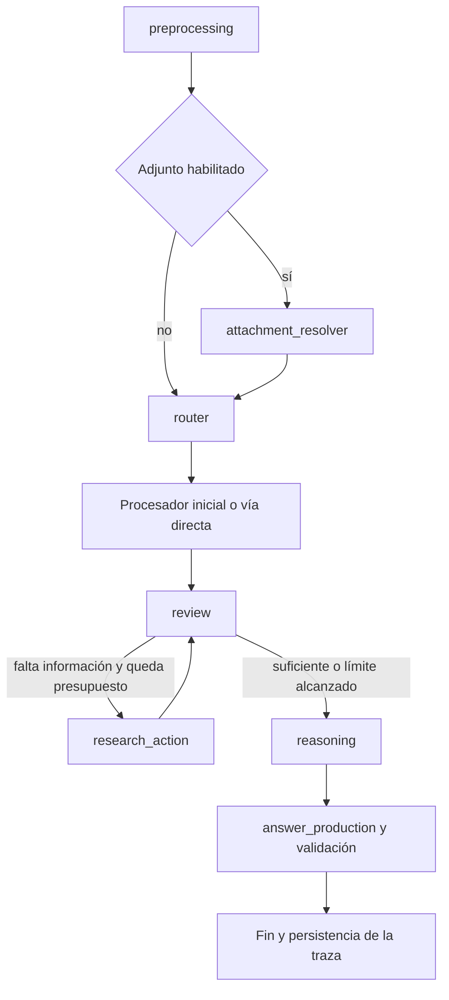

# Pipeline v2: investigación acotada y ejecución observable

La segunda versión conserva LangGraph y los procesadores por modalidad. Introduce una revisión de suficiencia de evidencias antes de resolver, permite encadenar herramientas y separa la resolución de la presentación de la respuesta.

## Flujo

El router conserva las rutas existentes. Una clasificación inválida se reintenta una vez y queda registrada si acaba utilizando la vía directa. La vía directa del router permite al revisor pedir herramientas; el perfil **Solo directo** desactiva expresamente esas herramientas y omite la revisión con LLM. Todas las acciones adicionales respetan las capacidades habilitadas.

El revisor puede buscar con una consulta breve, abrir una URL HTML o PDF, calcular mediante expresiones Python restringidas o solicitar hasta ocho instantes adicionales de un vídeo descargado. Conserva la evidencia anterior dentro del presupuesto de contexto y evita repetir una misma acción. Los fallos recuperables de adquisición quedan como notas para decidir otra acción; no se convierten en hechos.

## Resolución y formato

El razonador dispone de un presupuesto independiente y puede usar conocimiento general estable. Los hechos que dependen de una publicación, fuente o fecha concreta deben apoyarse en evidencia. No se fuerza `/no_think` en esta etapa. La temperatura de razonamiento es configurable y queda registrada.

La etapa final recibe la pregunta original y la solución de trabajo y produce exclusivamente la respuesta solicitada. Se comprueban algunas restricciones mecánicas: listas separadas por comas, orden alfabético o numérico, y forma de una jugada en notación algebraica. Si falla, dispone de una reparación. La persistencia de un error de formato produce un error explícito. Estas comprobaciones no demuestran la corrección semántica de la respuesta ni la legalidad de una jugada.

El cliente conserva los datos de uso y `finish_reason` de cada llamada. Una generación terminada por `length` produce un error de truncamiento, en lugar de publicar una respuesta incompleta como si fuera válida. Si ocurre durante la resolución, se permite un único intento conciso con `/no_think`, conservando el fallo inicial y una advertencia de recuperación en la traza. Si también falla, termina con error. Se elimina el atajo de contar filas de Wikipedia mediante expresiones regulares; los cálculos solicitados deben pasar por una operación explícita y verificable.

## Herramientas y multimedia

En Excel se conserva el plan de cálculo y una selección de los datos originales junto al resultado o análisis. Así el revisor puede comprobar qué filtro se aplicó y solicitar un cálculo adicional, en lugar de recibir únicamente una conclusión previa del modelo.

La calculadora funciona sin adjunto. Admite literales, operaciones aritméticas, comparaciones, indexación, comprensiones y un conjunto de funciones puras como `sum`, `sorted`, `len`, `range` y `zip`. Valida el AST y utiliza un subproceso con tiempo limitado. No admite imports, atributos ni funciones arbitrarias. Es una herramienta restringida de cálculo, no un sandbox del sistema operativo.

Las búsquedas web iniciales reformulan la pregunta en una consulta breve. Las acciones siguientes pueden reformularla de nuevo y seguir enlaces, incluidos documentos PDF de editoriales o repositorios distintos de Europe PMC. Se conservan enlaces de páginas abiertas para que el revisor pueda seguirlos sin depender exclusivamente del texto seleccionado.

Whisper aporta transcripciones con marcas temporales y permanece protegido durante el consumo completo de sus segmentos diferidos. El clasificador AST recibe una onda decodificada con PyAV mediante faster-whisper, por lo que no necesita invocar un ejecutable FFmpeg para abrir el archivo. Mencionar simplemente una grabación de audio no activa el reconocimiento de sonidos.

El VLM y AST utilizan CUDA si PyTorch la detecta; Whisper continúa en CPU con int8. El indicador del panel informa de la disponibilidad CUDA para PyTorch, no de que todos los modelos están usando GPU. La instalación multimedia utiliza la distribución CUDA 12.8 de PyTorch; puede recurrir a CPU cuando CUDA no está disponible. La plataforma debe disponer de una rueda compatible con ese índice.

El vídeo comienza con el muestreo limitado existente. El revisor puede examinar más instantes del mismo archivo sin volver a descargarlo. El muestreo sigue siendo parcial: no garantiza observar todos los eventos ni un máximo global. No se incorpora un motor de ajedrez, OCR para PDFs escaneados ni un sistema de identificación exacta de canciones.

## Configuración

Las variables están documentadas en `.env.example`:

| Variable | Valor inicial | Uso |
|---|---:|---|
| `LLM_REASONING_MAX_TOKENS` | 2048 | Presupuesto para resolver |
| `LLM_REASONING_TEMPERATURE` | 0.6 | Muestreo del razonador |
| `LLM_FINAL_ANSWER_MAX_TOKENS` | 128 | Presentación final |
| `LLM_TIMEOUT_SECONDS` | 120 | Timeout de una petición al LLM |
| `PIPELINE_MAX_ACTIONS` | 4 | Acciones adicionales de investigación |
| `PIPELINE_MAX_LLM_CALLS` | 16 | Máximo de llamadas LLM por pregunta |
| `PIPELINE_TIMEOUT_SECONDS` | 240 | Presupuesto temporal de la pregunta |
| `RUNTIME_DIRECTORY` | .runtime | Almacenamiento local |

Los límites de tiempo son cooperativos: se comprueban entre nodos y llamadas y acotan el timeout del LLM y el cálculo. Una inferencia local o lectura externa ya iniciada puede rebasar el presupuesto antes del siguiente punto de control. El máximo de acciones es adicional al procesamiento inicial. El grafo dispone también de un límite de recursión.

## Historial y trazas

El frontal y la terminal ejecutan `run_pipeline`. Cada pregunta crea un registro con UUID en `.runtime/runs/`, también si falla. Incluye versión del pipeline, pregunta, configuración, límites, actualizaciones por nodo, fuentes, decisiones, tiempos, peticiones y respuestas del modelo. No se copian las variables de entorno ni tokens de acceso. El directorio está excluido de Git.

El panel muestra tiempo total y tiempo acumulado de llamadas al LLM, además de un enlace a la traza JSON. Este tiempo de LLM incluye el transporte y la espera del servidor; no es una medición exclusiva de los kernels de inferencia y no incluye VLM, Whisper ni AST. Sus tiempos forman parte de los nodos multimedia.

Los experimentos completos se copian a `.runtime/experiments/`; el navegador sigue proporcionando una copia local y migra su historial al servidor al cargar la página. Se conservan preguntas, respuestas, puntuaciones, modelo y referencias a trazas. El panel muestra los veinte registros más recientes. Eliminar un experimento elimina su ficha persistida; sus trazas y medios se conservan para diagnóstico. Los vídeos reutilizables dentro de una ejecución se guardan en `.runtime/media/`. No hay limpieza automática ni política de retención de esos archivos.

API local:

- `GET /api/experiments`: historial persistido.
- `POST /api/experiments`: guardar o actualizar una ficha con UUID.
- `DELETE /api/experiments/{id}`: eliminar esa ficha.
- `GET /api/runs/{id}`: traza de una pregunta.

Las trazas contienen el texto de las preguntas y de los recursos procesados. Si se cambia `RUNTIME_DIRECTORY`, debe mantenerse ese destino fuera del repositorio versionado. Las respuestas de referencia GAIA se usan exclusivamente en el evaluador local y no se entregan al pipeline.

## Comparación histórica

La evaluación posterior de la V2 obtuvo **6/20 (30 %)** con **47,3 segundos** de
media. La configuración, revisión conservada, limitaciones y protocolo de evolución
se recogen en [evolucion-pipeline.md](evolucion-pipeline.md). El siguiente párrafo
describe el punto de partida anterior a esa evaluación.

La batería previa analizada obtuvo **3/20 (15 %)**, con **146 segundos** de tiempo acumulado y **7,3 segundos** de media. El nuevo ciclo puede aumentar la latencia: el experimento debe comparar acierto, errores técnicos y tiempo, no únicamente rapidez. Las ejecuciones históricas no aíslan causalmente la contribución de cada cambio.

Los tests normales aíslan las llamadas a modelos y servicios. La comparación real debe realizarse desde el panel, sin enviar resultados oficiales de forma automática.
