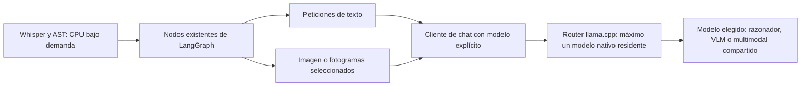

# Pipeline V3.1: modelos y memoria

## Alcance

V3 se conserva en el tag local `pipeline-v3.0.0`, sobre el commit `5dcd257`.
V3.1 añade selección independiente de razonador y VLM y un modo de servidor con
una sola instancia nativa residente. Mantiene LangGraph, sus capacidades y las
mejoras seleccionables; no incorpora respuestas específicas de la batería.

La justificación, literatura, benchmarks y restricciones del equipo están en
[seleccion-modelos-v3.1.md](seleccion-modelos-v3.1.md). Los resultados locales
se conservan en [resultados-v3.1.md](resultados-v3.1.md) y en el panel.

## Servidor y carga

```powershell
.\scripts\start_agent.ps1 -Mode frontend -ModelMode exclusive
```

El arranque usa `scripts/start_model_router.ps1`, que delega en el módulo Python
de gestión del servidor: llama.cpp con `--models-max 1`, 16K de contexto, una
secuencia, caché RAM de 512 MiB y descarga por inactividad a los 300 segundos.
`MODEL_CACHE_RAM_MIB` centraliza el límite; `--cache-ram` o `-CacheRamMiB` permiten
sobrescribirlo al arrancar. Cambiarlo exige reiniciar el servidor; no se modifica
una batería en curso. La primera serie comparativa conserva el valor anterior
del motor, 8192 MiB, y se documenta por separado.
Si ya existe un servidor incompatible con el modo solicitado, el arranque informa
del conflicto. El modo `single` conserva el arranque anterior.

Para descargar los tres candidatos públicos, con el router ya arrancado:

```powershell
uv run --env-file .env python -m huggingface_agents_langgraph.model_server download
uv run --env-file .env python -m huggingface_agents_langgraph.model_server status
```

Q8 es un contraste opcional adicional; necesita unos 9,53 GB para sus pesos:

```powershell
uv run --env-file .env python -m huggingface_agents_langgraph.model_server download --models unsloth/Qwen3.5-9B-GGUF:Q8_0
```

Las descargas son asíncronas. El panel ofrece los modelos una vez disponibles;
no lanza una inferencia para consultar su estado. Los archivos de pesos permanecen
en la caché local, fuera de Git. No se emplean APIs de pago en esta serie.

El cliente carga explícitamente el modelo elegido antes de inferir. Una instancia
dormida se detiene y se espera a confirmar el estado descargado antes de solicitar
su carga, porque el motor instalado rechaza `/models/load` si la instancia ya existe.
La respuesta de descarga puede llegar antes del cierre del proceso. Una instancia
que está cargando se espera
sin emitir una segunda carga. Al elegir la misma instancia para texto y visión,
no se intercambian pesos entre esas dos etapas.

Los modelos Transformers originales permanecen en CPU en modo exclusivo, puesto
que el límite de llama.cpp no controla sus reservas CUDA. Esa alternativa produjo
presión de RAM en el piloto y no forma parte de la serie principal. Whisper
conserva CPU/int8. El modo previo mantiene su política de dispositivos.



La gestión de modelos pertenece a la capa de inferencia; no añade nodos al grafo
del agente. Una instancia compartida conserva los mismos pesos al pasar de texto
a imagen. Dos modelos distintos requieren descargar y cargar pesos entre roles.

## Configuración y métricas

El panel permite elegir versión, mejoras, presupuestos, razonador, VLM, receta de
muestreo y semilla. Las recetas son: histórica, controlada común y una adaptación
por familia basada en las recomendaciones del autor. Se registra la petición
efectiva completa; una semilla fija no garantiza determinismo entre plataformas.
La adaptación por familia no reproduce todos los protocolos de benchmark.
El botón **V3.1 · Compartido Q5** prepara la configuración evaluada: ambos roles
en Qwen3.5-9B Q5 y cuatro mejoras activadas. Todos sus valores siguen siendo
editables. La selección V2 continúa disponible.

Las trazas conservan tiempos de nodos y llamadas, respuesta nativa, muestreo,
modelos, tiempo de carga y recursos del sistema. Los tiempos LLM incluyen carga
y transporte: no equivalen a tiempo de kernel en GPU. El tiempo de carga se
presenta también por separado en el historial y la comparación por pregunta.
El indicador «Modelos» suma peticiones al servidor, incluidas las visuales nativas;
el campo compatible `llm_duration_seconds` conserva ese agregado. El VLM original
de Transformers no pasa por ese cliente; para comparaciones entre versiones se
usa el tiempo completo del pipeline y las etapas de las trazas.

Se muestrean VRAM y RAM disponible a 1 Hz. El pico observado incluye escritorio
y otros procesos; puede omitir máximos entre muestras. El panel muestra acceso
a GPU, memoria del dispositivo, RAM disponible y estados sin mantenerlos despiertos.
Los estados de Whisper/AST reflejan los gestores del proceso del frontal. Las
baterías externas de CLI conservan su consumo en sus trazas y liberan sus modelos
CPU al terminar cada proceso.

## Reproducir la comparación

Para reproducir los límites de la serie, establecer en el entorno local:

```dotenv
MODEL_SERVER_MODE=exclusive
MODEL_LOAD_TIMEOUT_SECONDS=180
MODEL_CACHE_RAM_MIB=512
LLM_TIMEOUT_SECONDS=180
PIPELINE_TIMEOUT_SECONDS=360
```

Con ese entorno cargado, el runner ejecuta las variantes en procesos separados:

```powershell
uv run --extra multimedia --env-file .env python -m huggingface_agents_langgraph.model_trials smoke
uv run --extra multimedia --env-file .env python -m huggingface_agents_langgraph.model_trials evaluate --group-id mi-comparacion
uv run python scripts/analyze_model_trials.py --group-id mi-comparacion --output .runtime/mi-comparacion.md
```

La comparación de precisión con caché acotada se reproduce con:

```powershell
uv run --extra multimedia --env-file .env python -m huggingface_agents_langgraph.model_trials evaluate --variants shared precision --group-id mi-comparacion-cache --name-prefix "V3.1 - Cache 512 MiB"
```

`smoke` verifica compatibilidad con entradas sintéticas y conserva respuestas sin
limpieza adicional. No es una evaluación representativa de calidad. `evaluate`
usa las veinte tareas de la referencia conservada, elimina las respuestas de sus
entradas y puntúa localmente después de ejecutar cada batería. No envía resultados
al leaderboard. Se guarda cada respuesta a medida que termina para revisar también
experimentos incompletos.

La selección final debe considerar acierto, errores, tiempo y memoria. Una mejora
de benchmark publicada o una carga exitosa no demuestra superioridad del agente.
