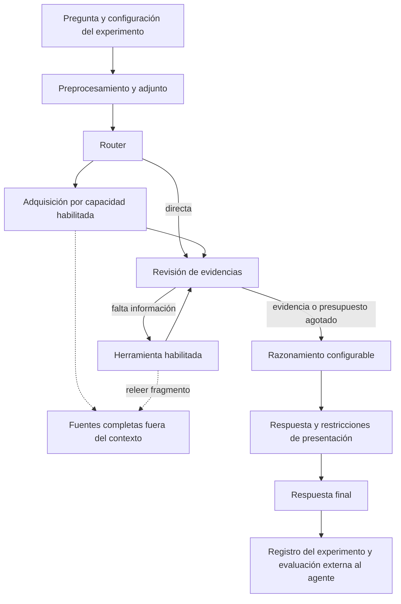

# Pipeline V3: mejoras seleccionables y evaluación por componentes

La V3 conserva LangGraph y las ramas de adquisición de V2. Añade cambios
seleccionables por experimento para evaluar su contribución individual y conjunta.
La referencia histórica permanece etiquetada como `pipeline-v2.0.0` y conserva
sus veinte respuestas y trazas originales. El historial general está en
[evolucion-pipeline.md](evolucion-pipeline.md).

## Versiones y controles

La configuración incluye `pipeline_version` y `improvements`. La versión 2 rechaza
mejoras activadas; las peticiones antiguas sin versión continúan utilizando V2.
La versión 3 permite activar cualquiera de estos componentes:

| Identificador | Comportamiento |
|---|---|
| `reasoning_control` | Control nativo de pensamiento en llamadas breves, presupuesto de razonamiento y una continuación acotada si se trunca |
| `answer_contract` | Orden explícito de listas y precisión decimal mediante código |
| `web_sources` | Lectura de páginas, extracción con Trafilatura, conservación de fuentes completas y relectura por identificador |
| `spreadsheet_tools` | Agregaciones multicolumna con Decimal, trazabilidad de filas y comprobación de filtros |
| `multimedia_tools` | Selección semántica de audio/visión y descarga explícita de la pista requerida |
| `calculation_tools` | Operaciones restringidas sobre texto/listas y entorno de ejecución sin credenciales de aplicación |

El panel selecciona V2 por defecto tras observar regresiones en la evaluación.
Al elegir V3 se pueden activar estas mejoras y desactivarlas individualmente. Los
presupuestos iniciales son 512 tokens de pensamiento y 1024 de solución. El
modo sin pensamiento utiliza solo el segundo presupuesto. Estos valores son
configurables y quedan en la ficha del experimento y en las peticiones registradas.

## Flujo



No se añade una jerarquía de agentes ni se sustituye el orquestador. La evaluación
consulta referencias únicamente después de que el agente haya producido respuestas.

## Razonamiento y presentación

El cliente conserva las peticiones V2 sin controles nativos adicionales. Con
`reasoning_control`, las llamadas breves deshabilitan pensamiento; la resolución
principal utiliza el modo y presupuesto seleccionados. En llama.cpp se utiliza
`chat_template_kwargs.enable_thinking` y `reasoning_budget_tokens`. La instalación
local comprobada anuncia soporte para presupuesto de pensamiento. Ollama utiliza
su control `reasoning_effort`, cuya interpretación depende del modelo; no se
atribuye allí un límite nativo exacto al presupuesto de tokens de pensamiento.

Ante un truncamiento se conserva el contenido parcial disponible y se permite
una continuación sin pensamiento, en lugar de reiniciar el análisis completo.
Los tokens de pensamiento y contenido pueden ser contabilizados conjuntamente
por el backend; se conservan tanto el uso comunicado como los parámetros enviados.
La generación y el conocimiento del modelo siguen siendo fuentes de error.

El contrato mecánico aplica únicamente restricciones explícitas: orden alfabético
o numérico de listas separadas por comas, y precisión decimal. No decide qué
elementos son verdaderos, no elimina calificativos de ingredientes o nombres y
no incorpora soluciones específicas de GAIA. La interpretación semántica de
entidades, categorías y relaciones sigue correspondiendo al modelo.

## Fuentes consultables

Se recuperan páginas completas de los resultados de búsqueda y Trafilatura
extrae contenido principal, tablas y enlaces. Si falla la lectura de una página,
el resumen del buscador se marca como `search_snippet`, con una indicación de
que no se ha leído la fuente. La extracción no garantiza conservar correctamente
todas las tablas ni acceder a páginas que requieren autenticación o JavaScript.

El selector compartido sigue acotando el contexto. La traza retiene por separado
el texto completo y asigna un identificador derivado de URL y contenido. El revisor
puede usar `read_source` con el identificador, un término literal y un desplazamiento
para recuperar hasta 8000 caracteres. El catálogo del prompt contiene identificadores,
procedencia y tamaños, sin copiar los documentos completos.

En Wikipedia se corrige, solo con esta mejora habilitada, el tratamiento de
elementos HTML vacíos dentro de contenedores ignorados. Si el enunciado pide una
versión por año, se consulta una revisión anterior al fin de ese año y se conserva
el enlace `oldid`. Este soporte inicial no interpreta cualquier expresión temporal
natural ni garantiza reconstruir páginas externas históricas.

## Cálculo, Excel y multimedia

Excel conserva los datos originales como fuente. El modelo selecciona operación,
columnas y filtros; el código opera sobre las celdas originales usando Decimal.
El resultado registra filas incluidas/excluidas y número de celdas numéricas.
Los filtros de filas deben citar una condición del enunciado que contenga el valor
filtrado. Esto impide algunas exclusiones inventadas, pero no demuestra por sí solo
que todas las columnas o condiciones elegidas sean semánticamente correctas.
Los planes no representables pasan a análisis general, con el rechazo documentado.

La calculadora amplía su lista restringida de funciones y métodos de cadenas.
El AST reescribe los métodos admitidos y exige receptores de texto en ejecución.
No admite atributos arbitrarios, imports, acceso a archivos o métodos no permitidos.
Con esta mejora, el intérprete y los adjuntos ejecutados reciben un entorno mínimo
sin variables de credenciales de la aplicación. Los subprocesos tienen timeout;
esto no equivale a un contenedor ni limita toda la memoria disponible del equipo.

En preguntas de vídeo, el LLM selecciona audio, visión o ambos. Una pregunta sobre
diálogo puede descargar únicamente audio y evitar el VLM. Si se necesita audio,
se valida la presencia de la pista: no se sustituye una transcripción ausente por
inferencias a partir de fotogramas. Audio y vídeo pueden descargarse por separado
sin obligar a fusionar formatos con un ejecutable FFmpeg.

El muestreo visual sigue siendo limitado y sus evidencias se identifican como
observaciones parciales. La V3 inicial mantiene el VLM de 256M, Whisper small y AST;
no se atribuyen mejoras de percepción a un cambio de modelo que no se ha realizado.
La identificación exacta de canciones, OCR y análisis de ajedrez mediante motor
especializado no forman parte de estos seis experimentos.

## Herramientas reutilizadas y alternativas investigadas

Se incorpora Trafilatura donde había un fallo demostrado de extracción. Se
mantienen DDGS, openpyxl, pypdf, yt-dlp y faster-whisper. Las herramientas oficiales
de Hugging Face son candidatas a adaptarse a LangGraph, pero el envoltorio oficial
de DDGS no cambia el buscador y el de transcripción no sustituye automáticamente
las ventajas de la integración existente. No se incorpora smolagents como segundo
orquestador ni una dependencia completa sin una comparación que justifique su uso.

La navegación textual de Open Deep Research inspira la relectura de fragmentos.
Crossref/arXiv, OCR y el ensayo de un VLM mayor requieren evaluaciones adicionales;
no se presentan como componentes implementados o validados en esta batería.

Referencias de implementación:

- [Servidor llama.cpp](https://github.com/ggml-org/llama.cpp/blob/master/tools/server/README.md).
- [Compatibilidad de Ollama](https://docs.ollama.com/api/openai-compatibility).
- [Trafilatura](https://trafilatura.readthedocs.io/en/latest/corefunctions.html).
- [Herramientas oficiales de Hugging Face](https://huggingface.co/docs/smolagents/reference/default_tools).
- [Navegador textual de Open Deep Research](https://github.com/huggingface/smolagents/blob/main/examples/open_deep_research/scripts/text_web_browser.py).
- [Revisiones de MediaWiki](https://www.mediawiki.org/wiki/API:Revisions).

## Ejecución de experimentos

El ejecutor toma únicamente identificador, pregunta y adjunto del experimento
conservado. No entrega sus respuestas, puntuaciones ni etiquetas al grafo.
Mantiene el mismo modelo y capacidades y cambia una mejora cada vez. También
ejecuta un control V2 contemporáneo y la combinación de mejoras.

```powershell
uv run --extra multimedia --env-file .env python -m huggingface_agents_langgraph.experiment_runner
```

Para seleccionar variantes:

```powershell
uv run --extra multimedia --env-file .env python -m huggingface_agents_langgraph.experiment_runner --variants reasoning_control combined
```

Los resultados se guardan después de cada pregunta en `.runtime/experiments/`.
El panel consulta el historial periódicamente y conserva las selecciones de
comparación. Incluye tiempo total, tiempo acumulado LLM, media, mediana, P95,
errores técnicos, llamadas, truncamientos, tokens comunicados y tiempos por etapa.
El tiempo LLM comprende transporte y espera; no es tiempo exclusivo de GPU.

Cada ejecución identifica el conjunto de preguntas, revisión Git y hash del código
Python/JavaScript y lockfile, incluyendo cambios pendientes. El hash de fuentes
debe permanecer fijo durante una comparación. Se conservan cachés de descargas
y modelos, pero no se reutilizan respuestas de otras variantes. El orden puede
afectar las cachés y las fuentes web pueden cambiar; una repetición por variante
no permite afirmar significación estadística ni mejora estable de latencia.

Una interrupción conserva las preguntas terminadas. Para continuar el mismo
experimento con idéntico código, configuración y preguntas:

```powershell
uv run --extra multimedia --env-file .env python -m huggingface_agents_langgraph.experiment_runner --resume UUID_DEL_EXPERIMENTO
```

`--limit` permite una comprobación parcial identificada como `smoke`; no recibe
puntuación de batería completa. El ejecutor no realiza envíos oficiales. Los
resultados de las ocho baterías se recogen en [resultados-v3.md](resultados-v3.md).
El análisis y la decisión de no promover la combinación como sustituta de V2 están
en [evolucion-pipeline.md](evolucion-pipeline.md).
