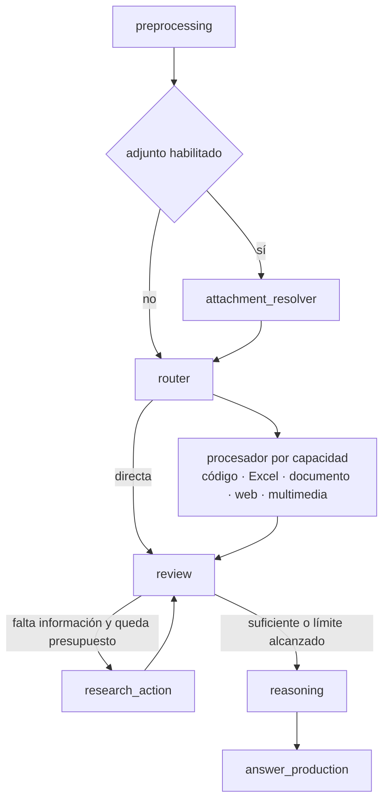
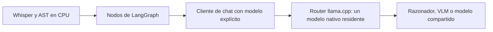

# El pipeline del agente

Qué hace el agente, cómo está construido y qué añadió cada versión. Los resultados medidos están
en [evaluacion.md](evaluacion.md); el razonamiento inicial del diseño, en
[analisis-inicial-gaia.md](analisis-inicial-gaia.md).

## Un solo grafo, las versiones son opciones

Hay un único `StateGraph` de LangGraph (`pipeline/graph.py`). V2, V3 y V3.1 no son grafos distintos:
se diferencian por la configuración del experimento (`ExperimentConfig`): `pipeline_version`, la lista
`improvements`, las capacidades habilitadas y los modelos.



| Etapa | Qué hace |
|---|---|
| `preprocessing`, `attachment_resolver` | Valida la entrada y descarga el adjunto desde el dataset GAIA. |
| `router` | La extensión del adjunto decide la capacidad; sin adjunto, el LLM clasifica la pregunta. Una clasificación inválida se reintenta una vez. |
| Procesadores | Aportan `Evidence` (`content`, `source`, `source_type`) con su procedencia. |
| `review` | El LLM decide si la evidencia basta o qué acción pedir: buscar, abrir una URL (HTML o PDF), calcular o examinar más instantes de un vídeo. |
| `research_action` | Ejecuta esa acción dentro de los presupuestos. No repite acciones y conserva la evidencia anterior. |
| `reasoning` | Resuelve con presupuesto propio. Los hechos que dependen de una fuente o fecha deben apoyarse en evidencia. |
| `answer_production` | Presenta solo la respuesta pedida y comprueba restricciones mecánicas (lista separada por comas, orden alfabético o numérico, notación algebraica). Permite una reparación. |

El enfoque es híbrido: el LLM interpreta, las herramientas ejecutan lo verificable. Todos los nodos
pasan por `traced_node` (traza por paso y presupuesto de tiempo), y los cinco de adquisición por
`_recover_acquisition`: un fallo recuperable queda como nota para que el revisor decida otra acción,
nunca como un hecho.

**Valores por defecto.** El valor por defecto es V2, no V3.1. V3.1 solo se activa con
`pipeline_version="3.1"`, que además usa el muestreo `controlled` y la semilla 42. Tampoco el modelo por
defecto (`Qwen3-8B Q5_K_M`) coincide con el recomendado para V3.1. No se debe deducir la versión activa
de las constantes: se inspecciona la configuración efectiva del experimento.

## Procesadores por capacidad

- **Código (`.py`):** el LLM decide si inspeccionar o ejecutar el archivo, con límite de 60 s.
- **Excel (`.xlsx`):** un plan de cálculo determinista (operación, columna, filtros) sobre los datos
  originales, con análisis general del LLM como respaldo. Se conserva el plan y una selección de las
  filas junto al resultado, para que el revisor compruebe qué filtro se aplicó.
- **Documentos (`.pdf`):** extracción de texto con número de página. Los PDF escaneados no se leen (no
  hay OCR).
- **Web y Wikipedia:** DDGS como buscador general; Europe PMC cuando la pregunta menciona papers (texto
  completo si hay acceso abierto); Wikipedia inglesa actual.
- **Multimedia:** Whisper (transcripción con marcas de tiempo, CPU/int8), AST (eventos acústicos, solo
  si la pregunta los menciona) y un VLM para imágenes y fotogramas (hasta 8, con intervalo mínimo de
  5 s). El muestreo de vídeo es parcial: no garantiza ver todos los eventos.
- **Calculadora:** expresiones Python restringidas (valida el AST, sin imports ni atributos arbitrarios)
  en un subproceso con tiempo limitado. No es un sandbox del sistema operativo.
- **Selector común de evidencias:** divide cualquier fuente textual en fragmentos y puntúa con una
  variante de BM25, conservando páginas y URLs, con tope `DOCUMENT_MAX_EVIDENCE_CHARACTERS`. Es léxico:
  puede no encontrar pasajes con términos distintos.

El perfil **Solo directo** desactiva las herramientas y omite la revisión con LLM.

## Qué añadió cada versión

| Versión | Qué cambia | Resultado local (20 tareas) |
|---|---|---|
| **V2** (tag `pipeline-v2.0.0`) | Revisión de suficiencia con acciones encadenadas y acotadas; resolución y presentación separadas; trazas por pregunta. | 6/20 (30 %), 47,3 s de media |
| **V3** (tag `pipeline-v3.0.0`) | Seis mejoras activables una a una: `reasoning_control`, `answer_contract`, `web_sources`, `spreadsheet_tools`, `multimedia_tools`, `calculation_tools`. | La combinación completa baja a 4/20: no sustituye a V2 |
| **V3.1** (tag `pipeline-v3.1.0`) | Razonador y VLM elegibles por separado, muestreo y semilla registrados, servidor con un solo modelo nativo residente. | Perfil recomendado: 9/20, 45,9 s |

### V2 en detalle

El cliente conserva `usage` y `finish_reason` de cada llamada: una generación cortada por `length` es un
error de truncamiento, no una respuesta válida. Si ocurre al resolver, hay un único intento conciso con
`/no_think` y el fallo inicial queda en la traza. Los límites de tiempo son cooperativos (se comprueban
entre nodos y llamadas): una inferencia ya iniciada puede rebasarlos.

### Las seis mejoras de V3

| Identificador | Comportamiento |
|---|---|
| `reasoning_control` | Pensamiento nativo desactivado en llamadas breves, presupuesto de razonamiento y una continuación acotada si se trunca. |
| `answer_contract` | Orden explícito de listas y precisión decimal mediante código. No decide qué elementos son verdaderos. |
| `web_sources` | Páginas completas con Trafilatura, fuentes retenidas fuera del contexto y relectura por identificador (`read_source`). En Wikipedia, revisión anterior al fin del año pedido. |
| `spreadsheet_tools` | Agregaciones multicolumna con `Decimal`, trazabilidad de filas y comprobación de que cada filtro cita una condición del enunciado. |
| `multimedia_tools` | El LLM elige audio, visión o ambos; descarga solo la pista necesaria; no sustituye un audio ausente por inferencias de fotogramas. |
| `calculation_tools` | Más funciones y métodos de texto permitidos, y entorno de ejecución sin credenciales de la aplicación. |

La V2 rechaza mejoras activadas; las peticiones antiguas sin versión siguen siendo V2. Presupuestos
iniciales de V3: 512 tokens de pensamiento y 1024 de solución.

### V3.1: modelos y memoria

Hardware de referencia: RTX 4060 Ti de 16 GB y 15,8 GiB de RAM. El servidor es llama.cpp en modo
router con `--models-max 1`, contexto de 16K, una secuencia, caché RAM de 512 MiB (`MODEL_CACHE_RAM_MIB`)
y descarga por inactividad a los 300 s. El cliente carga explícitamente el modelo elegido antes de
inferir; con el mismo modelo para texto y visión no se intercambian pesos. Los modelos Transformers
(SmolVLM, AST) se quedan en CPU en modo exclusivo, y Whisper en CPU/int8.



La gestión de modelos pertenece a la capa de inferencia; no añade nodos al grafo. El muestreo tiene
tres recetas: histórica, controlada común y una por familia de modelo. Se registra la petición efectiva
completa. Una semilla fija no garantiza determinismo entre plataformas.

## Configuración

Variables en `.env.example`:

| Variable | Valor inicial | Uso |
|---|---:|---|
| `LLM_REASONING_MAX_TOKENS` | 2048 | Presupuesto para resolver |
| `LLM_REASONING_TEMPERATURE` | 0.6 | Muestreo del razonador |
| `LLM_FINAL_ANSWER_MAX_TOKENS` | 128 | Presentación final |
| `LLM_TIMEOUT_SECONDS` | 120 | Timeout de una petición al LLM |
| `PIPELINE_MAX_ACTIONS` | 4 | Acciones adicionales de investigación |
| `PIPELINE_MAX_LLM_CALLS` | 16 | Máximo de llamadas LLM por pregunta |
| `PIPELINE_TIMEOUT_SECONDS` | 240 | Presupuesto temporal de la pregunta |
| `MODEL_SERVER_MODE`, `MODEL_CACHE_RAM_MIB` | `single`, 512 | Modo del servidor de modelos y caché de prefijos |
| `RUNTIME_DIRECTORY` | `.runtime` | Almacenamiento local (fuera de Git) |

## Trazas y registros

Cada pregunta crea un registro con UUID en `.runtime/runs/`, también si falla: versión del pipeline,
pregunta, configuración, límites, actualización de cada nodo, fuentes, tiempos, y peticiones y
respuestas del modelo (sin variables de entorno ni tokens). Los experimentos completos se copian a
`.runtime/experiments/`. Contienen texto de preguntas y recursos, así que `RUNTIME_DIRECTORY` debe
quedar fuera del repositorio.

El tiempo de LLM incluye transporte, espera y carga del modelo; no es tiempo de kernel en GPU y no
incluye VLM, Whisper ni AST. VRAM y RAM se muestrean a 1 Hz: el pico incluye el escritorio y otros
procesos. Las respuestas de referencia de GAIA solo las usa el evaluador, nunca el agente.

## Referencia V2 conservada

La V2 se conserva en `.runtime/baselines/v2-reference/` (fuera de Git): código en `source.zip`, la ficha
original, las 20 trazas y un manifiesto SHA-256. No se puede sobrescribir ni borrar desde la API.

```powershell
uv run python -m huggingface_agents_langgraph.baseline_archive            # crear (idempotente)
uv run python -m huggingface_agents_langgraph.baseline_archive --verify   # verificar
```

Para volver a ejecutarla sin cambiar de rama: descomprimir `source.zip` en
`.runtime/reproductions/v2-reference` y ejecutar `uv sync --frozen --extra multimedia` ahí. Esa
reproducción no se ha ejecutado como batería, y el manifiesto detecta modificaciones accidentales pero
no sustituye una copia de seguridad externa.

## Ejecutar experimentos desde la línea de comandos

El ejecutor toma únicamente el identificador, la pregunta y el adjunto de las 20 tareas conservadas;
nunca sus respuestas ni etiquetas. Guarda tras cada pregunta, no envía nada al evaluador oficial y se
reanuda con idéntico código, configuración y preguntas.

```powershell
uv run --extra multimedia --env-file .env python -m huggingface_agents_langgraph.experiment_runner
uv run --extra multimedia --env-file .env python -m huggingface_agents_langgraph.experiment_runner --variants reasoning_control combined
uv run --extra multimedia --env-file .env python -m huggingface_agents_langgraph.experiment_runner --resume UUID
uv run --extra multimedia --env-file .env python -m huggingface_agents_langgraph.experiment_runner --architecture ID
```

`--limit` hace una comprobación parcial marcada como `smoke`, sin puntuación de batería. Cada ejecución
registra el conjunto de preguntas, la revisión Git y el hash del código Python y del lockfile, que debe
permanecer fijo durante una comparación. Las comparaciones entre modelos están en
[evaluacion.md](evaluacion.md).

## Límites conocidos

- Una pasada por variante, con fuentes web cambiantes y cachés: no hay significación estadística.
- Los truncamientos del revisor y los fallos de formato en ajedrez siguen sin resolverse de forma general.
- No hay OCR para PDF escaneados, identificación exacta de canciones ni motor de ajedrez.
- El VLM de 256M original no interpretó el tablero de ajedrez, y con los modelos de V3.1 siguen fallando
  las respuestas de ajedrez en la validación de notación y las dos tareas visuales de la batería.
- Búsqueda y fuentes externas: DDGS y Europe PMC dependen de la red y no cubren todos los artículos.
